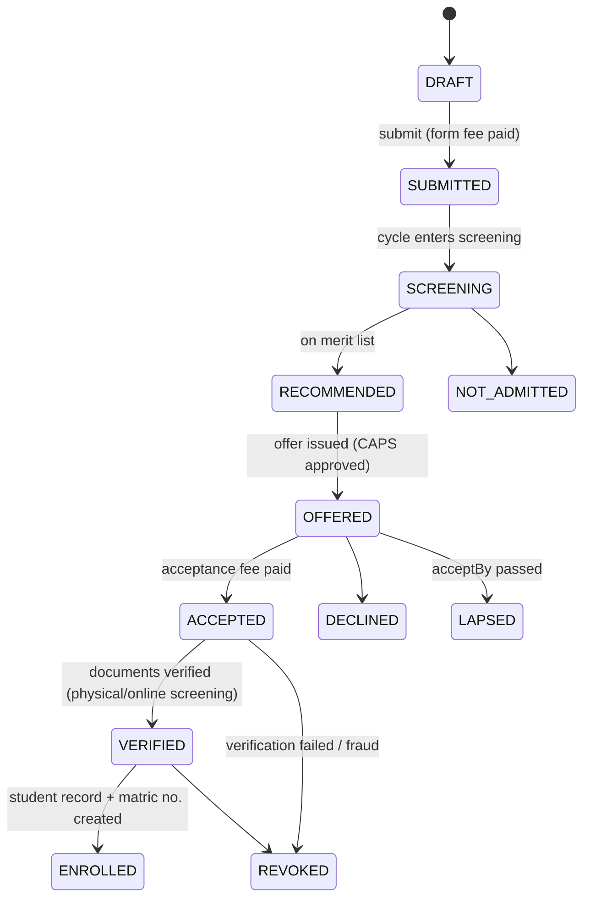
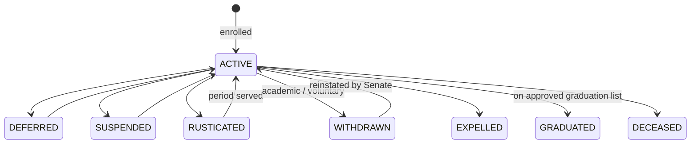
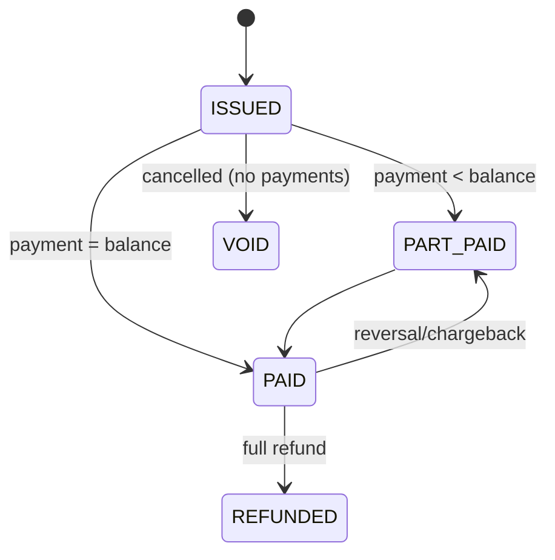
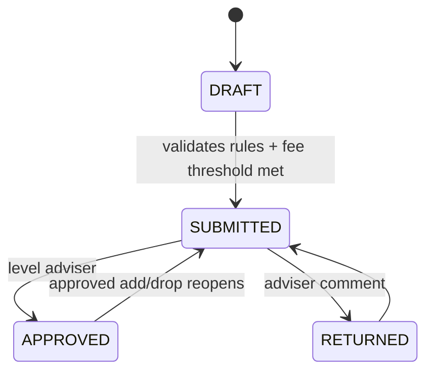
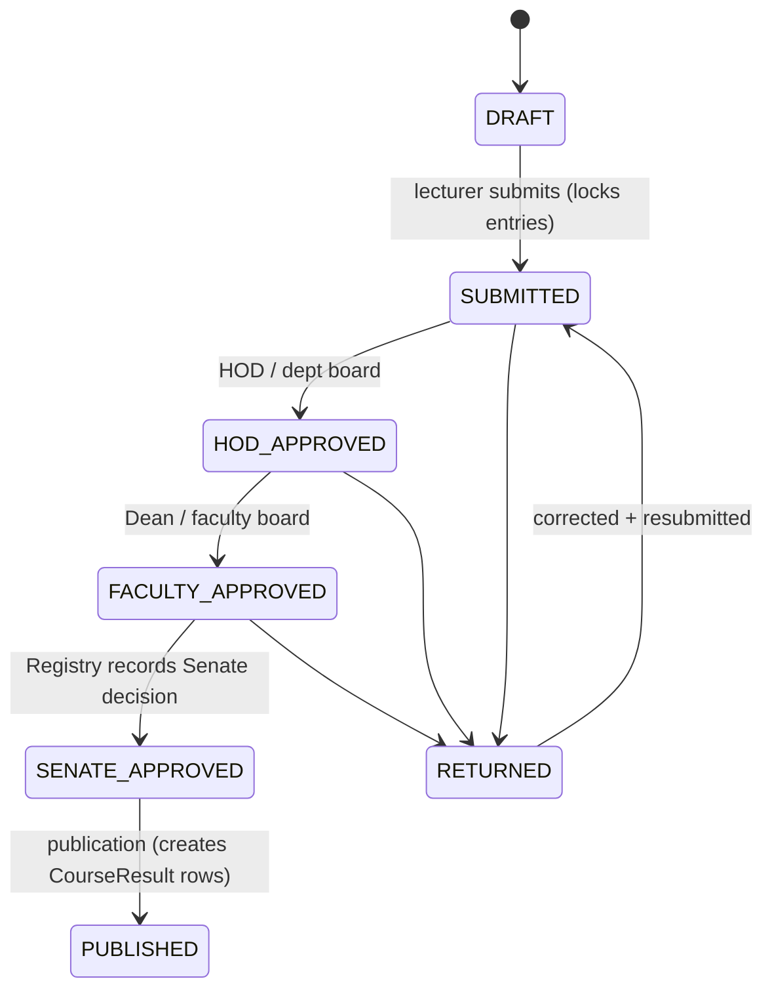
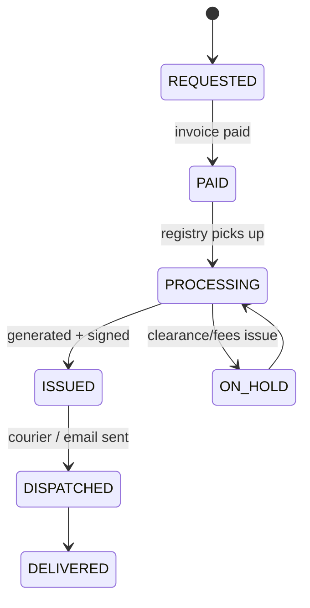
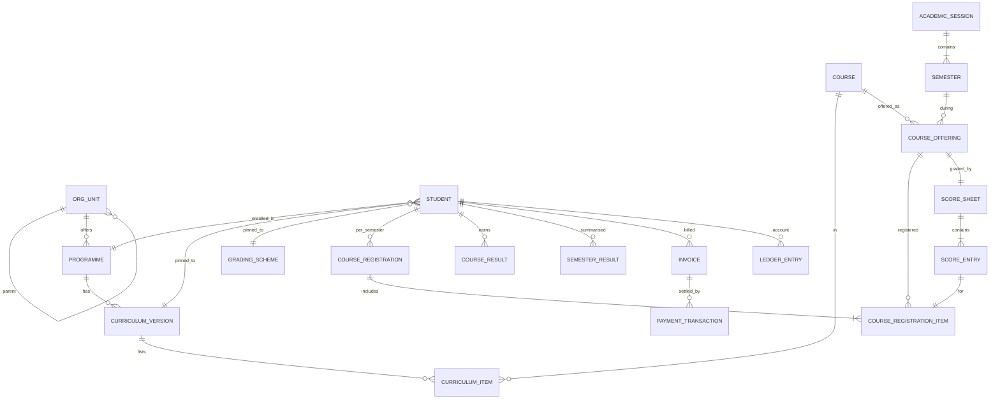
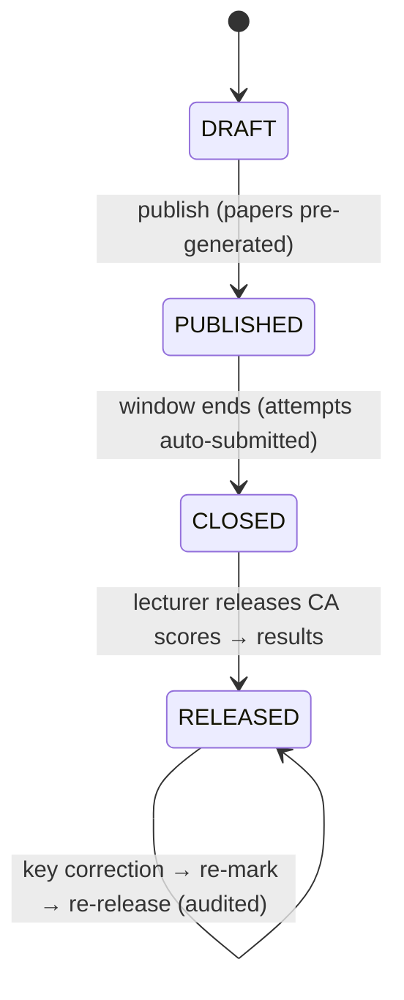

# 03 — Domain Model

Entities per bounded context, their key fields, invariants and lifecycles. This is the **logical** model. Physical conventions (naming, IDs, audit columns, RLS) are in [07-data-and-database.md](07-data-and-database.md).

> Every tenant entity implicitly has `id (uuidv7)`, `tenant_id`, `created_at`, `updated_at`, `created_by`, `updated_by` and, where mutable and concurrency-sensitive, `version` (optimistic lock). These aren't repeated below.

---

## 1. Platform (platform DB)

| Entity | Key fields | Notes |
|--------|-----------|-------|
| `Tenant` | slug, legalName, shortName, type (`UNIVERSITY`/`POLYTECHNIC`/`COLLEGE_OF_EDUCATION`), ownership (`FEDERAL`/`STATE`/`PRIVATE`), status, tier (`POOLED`/`DEDICATED`), shardId, region, suspendedReason, offboardingStartedAt, purgeAfter | slug is immutable and becomes the subdomain |
| `TenantDomain` | tenantId, hostname, kind (`SUBDOMAIN`/`CUSTOM`), verificationToken, verifiedAt, tlsStatus | Custom domains are verified by a DNS TXT record |
| `Tenant.template` | the template it was provisioned from, as `polytechnic@2` | [Spec 0034](specs/0034-provisioning.md) Q6. Null for the seed's institutions. Each later setting gets a default per template. From [spec 0041](specs/0041-institution-profiles.md) (P2-S0) the templates are `@2`, each with its institution-type profile |
| `TenantRegulatoryProfile` | tenantId, operatingStatus, state, regulatorReference, jambCode, version | [Spec 0033](specs/0033-tenant-registry.md) Q7. The regulator isn't stored: it follows the tenant's type |
| `TenantBranding` | tenantId, primaryColor, logo, logoMime, logoSha256 | [Spec 0033](specs/0033-tenant-registry.md) Q9, Q10. In the platform database, because the console holds no tenant credentials. Public by nature |
| `DbServer` | name, region, maxConnections, reservedConnections, secretRef | [Spec 0039](specs/0039-shards-and-migrations.md) Q2: a PostgreSQL server and its connection budget. `secretRef` is the prefix of its URL templates' variable names (`<prefix>_APP_URL`, `<prefix>_MIGRATOR_URL`), never a URL |
| `Shard` | name, kind (`POOL`/`DEDICATED`), secretRef, region, server, database, capacity, poolSize, status (`READY`/`ACTIVE`/`MAINTENANCE`/`RETIRED`), statusChangedAt | Spec 0039 Q3: the connection string lives in the environment, not the DB. A dedicated database's name is `univarse_t_` and 12 lower-case letters or digits. `isActive` is retired, unused until a later release drops it. **Placement** (Q7, PR C): an institution goes only onto an `ACTIVE` shard with room (a pool up to its `capacity` of institutions not purged; a dedicated database one, ever), and its `tier` is the shard's kind, both held by the `tenant_place` trigger for the runtime roles. A `READY` database becomes `ACTIVE` only when the console's create request claims it (`claim_ready_shard()`) |
| `MigrationRun` | jobId, commit, shard (none for the platform), database, status (`RUNNING`/`SUCCEEDED`/`FAILED`), startedAt, finishedAt, applied, lastMigration, errorCode | Spec 0039 Q8: one database's run per migrate job. It ends once (a trigger) and is never deleted; its error is a fixed code (`unreachable`, `no_credentials`, `migrate_failed`, `rls_failed`, `unexpected`), never a message |
| `ShardHealth` | shard, checkedAt, ok, latencyMs, lastSuccessAt, errorCode | Spec 0039 Q11: the worker's last check of a shard (`SELECT 1` and its latency), once a minute, a shard in maintenance included. Its error is a fixed code (`unreachable`, `timeout`, `no_credentials`, `unexpected`). The console reads it: it has no tenant credential |
| `PriceBook`, `Plan`, `Subscription`, `BillingContract`, `BillableCount`, `PlatformInvoice`, `PlatformCreditNote`, `PlatformPayment`, `BillingHold` | a price book's version, effectiveFrom (a session's start), rates per product and bundle in kobo, volume bands, minimum fee; a subscription's tenant, plan and products; a count's tenant, semester, product and number (no names); an invoice's lines, price-book version, VAT and total in kobo | Platform revenue only ([spec 0030](specs/0030-institution-billing.md)): billed per semester in arrears. Invoices, credit notes and payments are **append-only**; a correction is a credit note. A billing hold blocks new admission cycles and registrations only, never sign-in or records |
| `PlatformUser`, `PlatformSession`, `PlatformMfaFactor`, `PlatformRecoveryCode`, `PlatformMfaChallenge`, `PlatformOneTimeCode`, `PlatformKnownDevice`, `PlatformMailOutbox` | email, role (`OWNER`/`SUPER_ADMIN`/`SUPPORT`/`FINANCE`/`READ_ONLY`), active, lockout; a session's state (enrolment-only, step-up time); the TOTP secret under the console's own Transit key ([spec 0028](specs/0028-console-identity.md)) | Never stored in tenant DBs. Only the platform API reads them |
| `PlatformAuditVerification`, `PlatformSecurityEventRollup`, `PlatformAccessReview` | [Spec 0031](specs/0031-seeing-what-happened.md): a run of the audit chain's verification, with the head it saw; security events as per-minute counts, with no person, address or detail; and one attested access review a month, kept as it was attested. |
| `ProvisioningJob`, `ProvisioningStep` | a job's tenant (one each), template and version, the products to entitle, status (`QUEUED`/`RUNNING`/`FAILED`/`DONE`), who asked and their idempotency key, the sealed invite and its masked address, the failed step and its fixed code; a step's status, attempts and fixed error code | [Spec 0034](specs/0034-provisioning.md). The system of record: BullMQ only schedules. Each of the eight steps is idempotent, and a resumed job starts at the first step not done. The invite is sealed for the worker only and wiped by the invite step |
| `TenantProfileAssignment` | tenantId, template and version, the content hash (SHA-256 of the profile's canonical JSON), source (`PROVISIONING`/`SEED`/`BACKFILL`), status (`PENDING`/`ASSIGNED`/`FAILED`), a fixed error code, assignedAt | [Spec 0041](specs/0041-institution-profiles.md) Q6. Exactly which profile an institution was given: one row per institution and version, `ASSIGNED` only once its snapshot (`InstitutionProfile`, §3) has committed with the same hash. What was assigned never changes, and an `ASSIGNED` row never changes (a trigger). The worker writes it; the seed only asks (`PENDING`, `SEED`); the console reads it |
| `TenantDpa`, `TenantOnboarding` | the DPA's version, date signed and reference, who recorded it; when the institution's first administrator was ready (activated, with an authenticator) | [Spec 0034](specs/0034-provisioning.md) Q9, Q10: two items of the go-live checklist. No personal data. S11 extends the DPA record into the NDPA registers |
| `PlatformApproval` | the kind, the payload (ids and choices) and its SHA-256, the member it names, the reason, the status (`PENDING`/`APPROVED`/`REJECTED`/`EXPIRED`/`CANCELLED`/`EXECUTED`/`FAILED`), who asked and who decided, when it expires, a fixed failure code | [Spec 0037](specs/0037-approvals-suspension-notices.md) (E4). One engine for every two-person action. The approver isn't the requester or the person named, sends back the hash they were shown, and decides once before the expiry; the stored payload runs in the approval's own transaction. The payload never changes and the status moves forward once (a trigger, for every role). A `PENDING` request past its expiry reads as `EXPIRED` |
| `PlatformTenantSuspension` | the institution, the reason (a fixed list: a security incident, a regulator's order, the contract ended, the institution asked, other), a staff-only note, the status it had, who suspended it and when, who resumed it and when, when the worker ended its sessions and how many | [Spec 0037](specs/0037-approvals-suspension-notices.md) Q6, Q7. One person suspends, with step-up; the tenant goes `SUSPENDED` and every request there is 423. The row is the worker's job: it ends every session at the institution and records that; a resume waits for it and returns the status it had. The record never changes, a resume and the session ending are each written once (a trigger), and one is open per institution |
| `PlatformTenantOffboarding` | the institution, the reason (the contract ended, the institution asked, a regulator's order, other), a staff-only note, the status it had, who started it and when, the window's first and current end, a cancellation, the archive, the archive's session ending, one extension with its reason | [Spec 0038](specs/0038-offboarding-and-purge.md) Q2–Q6. One open per institution. Starting sets the tenant `OFFBOARDING`; the worker archives it after the last day (Nigerian time) and ends its sessions; a cancel within the window returns the status it had; an archive gets 14 more days, once. The record never changes (a trigger) |
| `PlatformOffboardingWarning` | the offboarding, the round (the first window or the extension), the days left (60, 45, 30, 14, 7, 1; or 14, 7, 1), how many IT Admins were found and emailed, when | Spec 0038 Q4. Once per round and day; written before its emails, which name it, so a retry sends none twice. Counts only (ADR-035) |
| `PlatformTenantExport` | the institution's export id and the institution, its state, when it was asked for, ready, failed and deleted, its size, and its counts of tables, rows and files | [Spec 0038](specs/0038-offboarding-and-purge.md) Q-B7. The platform's mirror of `DataExport`, written by the worker only; never the passphrase, the archive's key or its content. The console reads it |
| `PlatformTenantPurge` | the institution, the `tenant.purge` approval it used (or solo, with the owner's reason), when it began, then each step's time and facts: the shred ledger's op (keys), rows per tenant table, objects per bucket, platform rows per table, and the certificate with its SHA-256 | [Spec 0038](specs/0038-offboarding-and-purge.md) Q9–Q13. One per institution; an approval used once. Written only by the host's purge job (the migrator); each step once and only after the one before it (a check and a trigger); who authorised it never changes. The tenant keeps `purgedAt` and the certificate's hash as its tombstone |
| `PlatformNotice` | the kind (`ANNOUNCEMENT`/`MAINTENANCE`/`RELEASE_NOTE`), the title and body (plain text), the audience (every institution, chosen ones, or a release ring), a maintenance window, the status (`DRAFT`/`PUBLISHED`/`WITHDRAWN`), who wrote, published and withdrew it, until when it shows | [Spec 0037](specs/0037-approvals-suspension-notices.md) Q9. A draft may be edited; publishing checks it again and fixes it for good (a trigger): a correction is a new notice. Shown only as text (T34) |
| `PlatformNoticeDelivery` | the notice and one institution it reached, when it was withdrawn there, and the delivery log's counts: IT Admins found, emails queued, sent and failed, banners dismissed | Spec 0037 Q9–Q11. Written once, when the notice is published (its audience never moves); its arrival and withdrawal reach the tenant API's cache. Counts only: no address, name or user id (ADR-035) |
| `NoticeDismissal` (tenant) | the person, the notice, when | Spec 0037 Q10. A person hid a banner for themselves; never changed or removed |
| `DataExport` (tenant) | who asked and when, the **state** (`REQUESTED` → `BUILDING` → `READY` → `EXPIRED`, or `FAILED`), the passphrase sealed under the institution's key while it's needed, the build's lease and attempts, then the archive's key, size, SHA-256 and counts, when it's kept until | [Spec 0038](specs/0038-offboarding-and-purge.md) Q7, Q8. One open per institution, one a day (a failed one doesn't count). Its steps only go forward and who asked never changes (a trigger); the passphrase is wiped once the archive is sealed or the export fails; never deleted by the app (a purge removes the institution) |
| `PlatformIncident` | the title, severity (SEV1 to SEV4), whom it affects (every institution or chosen ones), the status (`INVESTIGATING`/`IDENTIFIED`/`MONITORING`/`RESOLVED`), whether personal data may be involved (yes, no, not yet known), when it started, when we became aware, when it was resolved, and the staff-only follow-up | [Spec 0037](specs/0037-approvals-suspension-notices.md) Q13. Its opening never changes; resolved is final (a recurrence is a new incident), but for the follow-up. When personal data may be involved, the 72-hour clock runs from awareness (docs/16 §8) |
| `PlatformIncidentUpdate` | the incident, its status, severity and personal-data flag then, the public text, an optional internal note, who posted it and when | Spec 0037 Q13. The timeline: append-only for every role (a trigger). The public text goes to the affected institutions; the internal note never leaves the console (the tenant API's role can't read it) |
| `PlatformIncidentTenant` | the incident and one institution it affects | Spec 0037 Q14. Decided when it's opened; each update moves it forward, so the institution's banner changes at once |
| `MigrationRun` | shardId, status, log | Resumable, idempotent (S8) |
| `TenantProduct` | tenantId, product, entitled, enabled, updatedBy | Product suite (ADR-020, [spec 0003](specs/0003-product-entitlements.md)). Active = entitled AND enabled. `core` is always active. The platform writes `entitled` and the institution's IT Admin switches `enabled`. A DB CHECK enforces enabled ⇒ entitled |
| `TenantDataKey` | tenantId, version, status (`ACTIVE`/`RETIRED`/`DESTROYED`), kekId, wrappedDek | Envelope encryption ([spec 0006](specs/0006-envelope-encryption.md)). At most one ACTIVE per tenant. Never deleted; destroying erases the wrap (crypto-shredding). Changes are platform-audited |
| `KeyReencryption` | tenantId (one row), reason (`ROTATION`/`LEGACY_V1`), requestedAt, completedAt, rowsReencrypted, leaseUntil | A tenant's pending key sweep ([spec 0006](specs/0006-envelope-encryption.md) E7, E9), claimed by the worker under a lease. Re-requested in place |
| `KeyDestruction` | op (the host protocol's operation id), tenantId, kind (`TENANT`/`RETIRED`), versions, reason, destroyedAt, auditSeq | One row per accepted key destruction, written in its own transaction with its platform audit event ([spec 0020](specs/0020-local-backups-and-shred-ledger.md) D8, D14). The database's evidence that a destruction committed; a repeat of the op is a no-op. Append-only |
| `TenantFeature` | tenantId, flag, enabled | |
| `PlatformAnnouncement`, `PlatformTicket`, `PlatformTicketMessage` | | Tenant admins ↔ UniVarse support |
| `PlatformAuditEvent` | actor, action, tenantId?, metadata, ip, prevHash, hash | Hash-chained |

**Contact change** (`platform_contact_change`, [spec 0032](specs/0032-contact-details.md)): one change of a member's address. `PENDING` → `CONFIRMED` → optionally `UNDONE`, or `REPLACED` by a newer request. Kind `SELF`, `ADMIN` or `COMMAND`. The row stays; its addresses and codes are blanked (Q12). `platform_user.email_verified_at` says the address is proven, and `password_reset_required` that an undo has left the password unusable. Institutions' users have the same in `contact_change`, under forced RLS, with addresses in field encryption and keyed hashes to find them by; `user_account` has the same two columns.

## 2. Identity & access

| Entity | Key fields | Invariants |
|--------|-----------|-----------|
| `User` | email?, phone?, username (matric no./staff no./application no.), passwordHash (argon2id), status (`PENDING_ACTIVATION`/`ACTIVE`/`LOCKED`/`DISABLED`), displayName, lastLoginAt | Unique `(tenant_id, lower(email))` and `(tenant_id, username)` |
| `MfaFactor` | userId, type (`TOTP`/`WEBAUTHN`/`RECOVERY_CODES`), secretEnc, label, lastUsedAt | Secrets encrypted with envelope encryption |
| `Session` | idHash, userId, createdAt, lastSeenAt, idleExpiresAt, absoluteExpiresAt, mfaAt, ip, userAgent, revokedAt | Stored hashed |
| `Role` | key, name, isSystem, permissions[] | System roles are seeded. Tenants may create custom roles from the permission catalog |
| `RoleAssignment` | userId, roleId, scopeType (`INSTITUTION`/`ORG_UNIT`/`PROGRAMME`/`COHORT`/`COURSE_OFFERING`/`HOSTEL`), scopeId, validFrom, validTo, grantedBy, reason | Temporal (acting HOD, tenure). Granting is audited and needs step-up. `scopeId` is null exactly when the scope is `INSTITUTION` (a database CHECK, [spec 0018](specs/0018-policy-service.md)) |
| `ActivationToken`, `PasswordResetToken` | tokenHash, userId, channel, expiresAt, usedAt | Single-use, ≤ 30 min |
| `LoginAttempt` | username, ip, success, reason | For lockout and threat detection |

**System roles** (seed): `INSTITUTION_ADMIN`, `REGISTRAR`, `EXAMS_RECORDS_OFFICER`, `ADMISSIONS_OFFICER`, `BURSAR`, `BURSARY_OFFICER`, `DEAN`, `HOD`, `LEVEL_ADVISER`, `LECTURER`, `STUDENT_AFFAIRS_OFFICER`, `HOSTEL_OFFICER`, `LIBRARIAN`, `CLEARANCE_OFFICER`, `MANAGEMENT_VIEWER`, `HELPDESK_AGENT`, `STUDENT`, `APPLICANT`.

## 3. Organization

Planned in [spec 0040](specs/0040-phase-2-institution-setup.md) (Phase 2), from the owner's guidance documents. `OrgUnit` and its root exist today; the rest is built slice by slice. Rank, office and governance membership are separate things: a Chief Lecturer (rank) may be HOD (office) and sit on the Academic Board (membership).

| Entity | Key fields | Notes |
|--------|-----------|-------|
| `InstitutionProfile` | template and version, content hash, the profile (`jsonb`: unit types and their hierarchy rules; qualifications with their family, award type, level labels and regulators; the semesters a session holds; staff categories, cadres and ranks, employment types and statuses; offices; governance bodies with their kind and function; approval chains; period and window types; regulators), source, assignedAt | **Built in P2-S0** ([spec 0041](specs/0041-institution-profiles.md) Q4, ADR-039). The snapshot of the institution-type profile the institution was assigned, in its own database: **append-only**, one row per template version. Each later slice projects its part into its own editable tables (S1 the unit types, S3 the staff catalogues, …), in SQL for institutions already live; the institution's edits live there, never here. Keys are stable lower-case `snake_case` with each type's own names (Q3). No code branches on the type (a lint rule, Q10) |
| `OrgUnitType` | key, name (the institution's own word: "School" or "Faculty"), kind (`ACADEMIC`/`ADMINISTRATIVE`/`RESEARCH`), status | Configurable per institution (spec 0040 Q2). Replaces today's fixed `OrgUnitType` enum by expand → migrate → contract |
| `OrgUnit` | code, name, typeId, parentId, path (materialised), status (`ACTIVE`/`INACTIVE`/`ARCHIVED`), codeLockedAt?, description | One parent (except the root); never its own ancestor; an archived unit takes no new active child; referenced units are archived, never deleted (Q12). The `path` enables scope checks (`resource.path` starts with `scope.path`). A code used in an issued identifier is locked (Q11) |
| `OrgUnitChange` | unitId, kind (`CREATED`/`RENAMED`/`MOVED`/`CODE_CHANGED`/`ARCHIVED`/`REACTIVATED`), before, after, effectiveFrom, by, reason | Append-only. Gives the tree "as at a date" (Q12) |
| `StaffProfile` | userId, staffNumber, title, categoryId, cadreId, rankId, gradeId?, primaryOrgUnitId, employmentType, employmentStatus | Employment type (permanent, contract, part-time, adjunct, visiting, …) and status (active, on leave, retired, …) are separate (spec 0040 Q7) |
| `StaffCategory`, `StaffCadre`, `StaffRank`, `StaffGrade` | per-institution catalogues seeded by the profile: a cadre's ranks in order | E.g. lecturer cadre: … Senior Lecturer → Associate Professor/Reader → Professor (university); … Principal Lecturer → Chief Lecturer (polytechnic) `[VERIFY]` per the institution's Scheme of Service |
| `Office` | key, name (HOD, Dean, Provost, Director, Programme Coordinator, Level Coordinator…), the role it grants, its scope kind (unit or programme) | An office is authority, not a rank |
| `Appointment` | staffId, officeId, scopeId (unit or programme), from, to?, acting?, by, reason | Grants the office's role for its dates, scoped (an appointment as HOD → `ORG_UNIT` on that department). Ends on its date (T41). Audited, step-up |
| `GovernanceBody`, `GovernanceMembership` | Governing Council, Senate or Academic Board, Faculty Board, committees; a member's position (chair, secretary, member) and dates | Decision-making bodies, not levels of the tree. Approval chains name them (Q5) |

## 4. Curriculum

| Entity | Key fields | Invariants |
|--------|-----------|-----------|
| `Qualification` | key (`BSC`, `BENG`, `MSC`, `PHD`, `ND`, `HND`, `NID`, `NCE`, `BED`, `PGDE`…), name, family, level labels, the rule module it uses | Per institution, from its profile. A dual-mandate college holds NCE and degree qualifications side by side (spec 0040 Q8). Rules are chosen by the qualification, never by the tenant (Q10) |
| `Programme` | code, name, qualificationId, primary owning unit (department), participating units[], coordinator, normal/minimum/maximum duration, entry modes[] (UTME, Direct Entry, **HND admission**, transfer, part-time…), minUnitsToGraduate, study mode, status, accreditation status, effectiveFromSession | One primary owner, optional participants (Q3). Durations configurable per programme, never assumed |
| `ProgrammeOption` | programmeId, code, name (an option, a specialisation, an **NCE subject combination**) | |
| `ProgrammeProgression` | fromProgrammeId (ND), toProgrammeId (HND), conditions | A formal link with its own admission checks, never an automatic promotion |
| `AccreditationRecord` | programmeId?, regulator (`NUC`/`NBTE`/`NCCE`), status, reference, from, to?, reviewDate | Basic records in Phase 2; full accreditation management later. External approval is never internal approval |
| `Course` | code (`CSC 201`), title, description, creditUnits, level (by label), ownerUnitId, tags[] (core, elective, GST, foundation, professional, practical, workshop, project, SIWES…), contact hours by component (theory, practical, workshop, laboratory, studio, fieldwork), status | Unique `(tenant, code)`. Tags, not one category: a course can be core *and* GST. Unit changes only affect **future** offerings |
| `CourseEquivalence` | courses on each side (one-to-one, one-to-many, many-to-one), reason, effectiveFromSession, approved by/at, programme restriction? | An explicit, approved decision; never inferred from similar names (T45) |
| `CurriculumVersion` | programmeId, version (`2025.1`), effective admission session (cohort), status (`DRAFT`/`SUBMITTED`/`IN_REVIEW`/`RETURNED`/`APPROVED`/`PUBLISHED`/`RETIRED`), regulator reference/edition? | **Immutable once published** (a database trigger, T40); a change is a new draft copied from it. Students are pinned to their cohort's version (Q4) |
| `CurriculumItem` | versionId, courseId, level, period (semester or special period), requirement (`CORE`/`ELECTIVE`/…), groupId? | |
| `CurriculumGroup` | versionId, level, period, name, min/max courses, min/max units, mandatory selections, option restriction? | Elective rules |
| `CurriculumRule` | versionId, courseId?, kind (`PREREQUISITE`/`COREQUISITE`), expression (pass X; pass one of; complete; min units; completed level; AND/OR) | Evaluated by a pure function in `packages/domain` (Q15) |
| `CurriculumRequirement` | versionId, type (`SIWES`/`TEACHING_PRACTICE`/`PROJECT`/`PRACTICAL`), level, period, duration, conditions | Configuration only in Phase 2; the operations come later |
| `CurriculumApproval` | versionId, stage (an office or a governance body), decision (`APPROVED`/`RETURNED`/`REJECTED`), by, at, comment, documents | Append-only history. The chain is configurable per institution (Q5); external regulator approval is a separate event |

## 5. Academic calendar

| Entity | Key fields | Invariants |
|--------|-----------|-----------|
| `AcademicSession` | name (`2025/2026`), startDate, endDate, status (`DRAFT`/`SCHEDULED`/`ACTIVE`/`COMPLETED`/`ARCHIVED`), activatedAt, closedAt | At most one `ACTIVE` per tenant |
| `AcademicPeriod` | sessionId, kind (`SEMESTER`/`SUMMER`/`SIWES`/`INDUSTRIAL_ATTACHMENT`/…), number?, name, startDate, endDate, status | At most one `ACTIVE` semester per tenant, inside the active session. Special periods (a SIWES period) aren't forced into a semester. Later sections' `semesterId` is a period of kind `SEMESTER` |
| `CalendarWindow` | type (`APPLICATION`/`COURSE_REGISTRATION`/`LATE_REGISTRATION`/`ADD_DROP`/`FEE_PAYMENT`/`SCORE_ENTRY`/`EXAMINATION`/`HOSTEL_APPLICATION`/`CLEARANCE`/`GRADUATION_PROCESSING`/`SIWES_APPLICATION`/`SIWES_ASSESSMENT`/`PROJECT_SUBMISSION`/…), sessionId, periodId?, opensAt, closesAt, status | Stored UTC; defined, displayed and judged in `Africa/Lagos` on server time only (T44) |
| `CalendarWindowOverride` | windowId, scope (unit or programme), opensAt, closesAt, reason, by | Precedence: programme > department > school/faculty > institution. Overrides only their own window. "The window for this student" is computable and shown |
| `RolloverRun` | source session, target session, idempotency key, stage, dry-run report, status (`DRY_RUN`/`CONFIRMED`/`RUNNING`/`PARTIAL`/`DONE`/`FAILED`), operation results, failures, started/completed, by | Dry run first; explicit confirmation; resumable without repeating done operations; every stage audited (spec 0040 Q6) |

## 6. Admissions

| Entity | Key fields |
|--------|-----------|
| `AdmissionCycle` | sessionId, name, entryModes[], formFeeItemId, status (`DRAFT`/`OPEN`/`SCREENING`/`OFFERS`/`CLOSED`), aggregateFormula (config), quotaPolicy (config) |
| `Applicant` | userId, surname, firstName, otherNames, dob, sex, stateOfOrigin, lga, nationality, phone, email, photoFileId |
| `Application` | cycleId, applicantId, applicationNumber, entryMode, jambRegNumber, utmeScore, utmeSubjects[], firstChoiceProgrammeId, secondChoiceProgrammeId?, status, submittedAt |
| `OlevelSitting` / `OlevelGrade` | examBody (`WAEC`/`NECO`/`NABTEB`/`GCE`), examYear, examNumber, scratchCardRef?, subjects+grades, verificationStatus |
| `DirectEntryQualification` | type (`A_LEVEL`/`ND`/`NCE`/`IJMB`/`JUPEB`/`DEGREE`), institution, grade/CGPA, fileId |
| `ScreeningScore` | applicationId, component (`POST_UTME`/`INTERVIEW`/`OLEVEL_POINTS`), score, source (`IMPORT`/`MANUAL`) |
| `MeritList`, `MeritListEntry` | cycleId, programmeId, quotaCategory (`MERIT`/`CATCHMENT`/`ELDS`/`DISCRETIONARY`), rank, aggregate, decision |
| `AdmissionOffer` | applicationId, programmeId, entryLevel, status, offeredAt, acceptBy, acceptedAt, capsStatus |
| `DocumentVerification` | applicationId, documentType, fileId, status, officerId, comment |

## 7. Student records

| Entity | Key fields | Invariants |
|--------|-----------|-----------|
| `Student` | userId, matricNumber, applicationId?, programmeId, curriculumVersionId, gradingSchemeId, cohortSessionId, entryMode, entryLevel, currentLevel, status, academicStanding, expectedGraduationSessionId, isSpillover | matricNumber unique per tenant and **immutable** except by audited correction. gradingSchemeId is pinned at enrolment |
| `StudentPersonal` | studentId, dob, sex, stateOfOrigin, lga, address, nextOfKin, disability?, ninEnc?, bloodGroup? | Restricted access (sensitive) |
| `StudentStatusChange` | studentId, from, to, reason, effectiveFrom, effectiveTo?, approvedBy, documentFileId | Append-only history |
| `ProgrammeTransfer` | studentId, fromProgrammeId, toProgrammeId, creditedCourses[], status, approvals | |

## 8. Finance

| Entity | Key fields | Invariants |
|--------|-----------|-----------|
| `FeeItem` | code, name, category (`TUITION`/`ACCEPTANCE`/`APPLICATION`/`SUNDRY`/`HOSTEL`/`TRANSCRIPT`/`PENALTY`/`OTHER`), revenueCode (TSA/GL), isRefundable | |
| `FeeSchedule` | sessionId, name, status (`DRAFT`/`APPROVED`), rules[] (criteria → items+amounts), installmentPlan | Approved schedules are immutable. Changes create a new version |
| `Invoice` | number, payerType (`STUDENT`/`APPLICANT`/`EXTERNAL`), payerId, sessionId, purpose, lines[], totalKobo, paidKobo, status, dueAt | `paidKobo ≤ totalKobo` unless there's an overpayment credit. Lines are immutable once issued |
| `LedgerEntry` | accountId (per payer), type (`CHARGE`/`PAYMENT`/`WAIVER`/`REFUND`/`ADJUSTMENT`/`REVERSAL`), amountKobo (signed), invoiceId?, paymentId?, memo | **Append-only.** Balance = Σ amount. Corrections are reversal entries |
| `PaymentTransaction` | invoiceId, gateway, merchantReference (ours), gatewayReference (RRR/Paystack ref), amountKobo, channel, status (`INITIATED`/`PENDING`/`SUCCEEDED`/`FAILED`/`ABANDONED`/`REVERSED`), verifiedAt, rawPayloadHash | Unique `(gateway, gatewayReference)`. Only a server-side verification or signed webhook moves it to `SUCCEEDED` |
| `Receipt` | number (sequential per tenant), paymentTransactionId, verificationCode, fileId | |
| `Waiver` / `Scholarship` | payerId, feeItemId?, percent/amountKobo, reason, status, requestedBy, approvedBy | Requester ≠ approver |
| `Refund` | paymentTransactionId, amountKobo, status, approvals, externalRef | |
| `GatewayConfig` | gateway, publicKey, secretKeyEnc, webhookSecretEnc, subaccount/serviceTypeIds, mode (`TEST`/`LIVE`) | The tenant owns the gateway account |
| `ReconciliationRun` / `ReconciliationItem` | gateway, window, matched, missingLocal, missingRemote, amountMismatch | |

## 9. Course registration

| Entity | Key fields | Invariants |
|--------|-----------|-----------|
| `CourseOffering` | courseId, semesterId, capacity?, status (`PLANNED`/`OPEN`/`CLOSED`), assessmentSchemeId | Unique `(courseId, semesterId)` (sections optional later) |
| `CourseOfferingStaff` | offeringId, staffId, role (`COORDINATOR`/`LECTURER`/`EXAMINER`) | Grants `COURSE_OFFERING` scope implicitly |
| `CourseRegistration` | studentId, semesterId, level, status (`DRAFT`/`SUBMITTED`/`APPROVED`/`RETURNED`), totalUnits, submittedAt, approvedBy/At | One per student per semester |
| `CourseRegistrationItem` | registrationId, offeringId, attemptType (`FRESH`/`CARRYOVER`/`REPEAT`/`ELECTIVE`/`AUDIT`), status (`ACTIVE`/`DROPPED`) | A student can't hold two active items for the same course in a semester |
| `AddDropRequest` | registrationId, add[], drop[], status, approvals | Only inside the ADD_DROP window |

## 10. Examinations

| Entity | Key fields |
|--------|-----------|
| `ExamPeriod` | semesterId, name, startDate, endDate, status |
| `Venue` | code, name, type (`HALL`/`LAB`/`CLASSROOM`/`CBT_CENTRE`), capacity, examCapacity, location |
| `ExamSlot` | examPeriodId, offeringId, startsAt, endsAt, status |
| `ExamSlotVenue` | slotId, venueId, allocatedSeats |
| `InvigilatorAssignment` | slotId, venueId, staffId, role (`CHIEF`/`INVIGILATOR`) |
| `ClassAttendance` (optional) | offeringId, studentId, sessionsHeld, sessionsAttended | For the eligibility rule |
| `ExamEligibility` | registrationItemId, eligible, reasons[] (`FEES`/`ATTENDANCE`/`NOT_APPROVED`) |
| `ExamDocket` | studentId, semesterId, verificationCode, fileId |
| `MalpracticeCase` | studentId, offeringId, description, evidenceFileIds, status, decision, sanction |

Invariants: no student has two overlapping exam slots, venue seats ≥ candidates, and no invigilator is double-booked (checked on save; the timetable UI shows conflicts).

## 11. Results

| Entity | Key fields | Invariants |
|--------|-----------|-----------|
| `GradingScheme` | name, bands[] ({minScore, maxScore, grade, gradePoint, isPass}), passMark, effectiveFromCohortSessionId, status | Immutable once used. New rules mean a new scheme |
| `AssessmentScheme` | components[] ({key: `CA1`, label, maxScore}), examMaxScore | Σ max = 100 |
| `ScoreSheet` | offeringId, status, currentStage, version, submittedBy/At, lockedAt, checksum | One per offering. Editable only in `DRAFT`/`RETURNED` |
| `ScoreEntry` | scoreSheetId, studentId, registrationItemId, components (json), examScore, total, grade, gradePoint, remark (`ABS`/`INC`/`MAL`/`SICK`/null) | Scores within component max. total = Σ components (+ rounding rule) |
| `ScoreSheetEvent` | scoreSheetId, fromStatus, toStatus, action (`SUBMIT`/`APPROVE`/`RETURN`/`PUBLISH`), actorId, comment, snapshotHash | Append-only. snapshotHash = hash of all entries at that moment |
| `CourseResult` | studentId, courseId, offeringId, semesterId, sessionId, creditUnits, score, grade, gradePoint, attemptNumber, attemptType, remark, publishedAt, sourceScoreSheetVersion | **Immutable.** Changes only via `ResultAmendment` |
| `SemesterResult` | studentId, semesterId, tcu, tcp, gpa, cumulativeTcu, cumulativeTcp, cgpa, outstandingCourses[], standing, computedAt, engineVersion | Recomputed from `CourseResult` by the domain engine |
| `ResultAmendment` | courseResultId, oldValues, newValues, reason, evidenceFileId, status, approvals[] | Must pass the same approval stages as the original |
| `ResultRemarkCode` | code, label, gradeTreatment (`AS_F`/`EXCLUDE`/`PENDING`) | `[CONFIG]` |

The stages are `[CONFIG]` per tenant (`results.approvalStages`). Some institutions publish provisionally after the faculty stage. `RETURNED` always goes back to the lecturer, with a mandatory comment.

## 12. Graduation, clearance and transcripts

| Entity | Key fields |
|--------|-----------|
| `ClearanceTemplate` | purpose (`GRADUATION`/`WITHDRAWAL`/`TRANSFER`/`SESSION_END`), steps[] ({unit, order, dependsOn[], autoCheck?}) |
| `ClearanceCase` | studentId, templateId, status (`OPEN`/`IN_PROGRESS`/`CLEARED`/`BLOCKED`) |
| `ClearanceStep` | caseId, unit (`DEPARTMENT`/`FACULTY`/`LIBRARY`/`BURSARY`/`HOSTEL`/`SPORTS`/`STUDENT_AFFAIRS`/`MEDICAL`/`ALUMNI`), status (`PENDING`/`CLEARED`/`REJECTED`), officerId, comment, autoResult | Auto-checks: bursary → ledger balance ≤ 0, hostel → no open allocation/damages, library → integration or manual |
| `DegreeAudit` | studentId, curriculumVersionId, satisfied, missingCourses[], unitsEarned, finalCgpa, proposedClass, computedAt |
| `GraduationList` | sessionId, orgUnitId (faculty), status (`DRAFT`/`FACULTY_APPROVED`/`SENATE_APPROVED`), entries[] |
| `GraduationListEntry` | studentId, finalCgpa, degreeClass, awardTitle, graduationDate, notes |
| `TranscriptRequest` | requesterStudentId, type (`STUDENT_COPY`/`OFFICIAL`), destination (institution/email/address), deliveryMethod (`EMAIL_PDF`/`COURIER`/`PICKUP`), invoiceId, status, trackingRef |
| `IssuedDocument` | type (`TRANSCRIPT`/`CERTIFICATE`/`RECEIPT`/`DOCKET`/`ADMISSION_LETTER`/`STATEMENT_OF_RESULT`), subjectId, fileId, sha256, verificationCode, issuedAt, revokedAt | Public verification by code |
| `NyscList`, `NyscListEntry` | sessionId, batch, entries with the required NYSC fields `[VERIFY]` format |

## 13. Hostel

| Entity | Key fields |
|--------|-----------|
| `Hostel` | name, sex (`MALE`/`FEMALE`/`MIXED`), location, status |
| `Room` | hostelId, block, number, capacity, type, isReserved |
| `BedSpace` | roomId, label, status (`AVAILABLE`/`HELD`/`OCCUPIED`/`OUT_OF_SERVICE`) |
| `AllocationRound` | sessionId, eligibilityRules (config), priorityRules (config), window |
| `HostelApplication` | studentId, roundId, preferences[], status |
| `HostelAllocation` | studentId, bedSpaceId, sessionId, status (`HELD`/`CONFIRMED`/`EXPIRED`/`VACATED`), holdExpiresAt, invoiceId, checkInAt, checkOutAt, damages[] |

Invariant: a bed space has at most one `HELD`/`CONFIRMED` allocation per session (enforced with a partial unique index).

## 14. Communications, helpdesk, files, audit, settings

| Entity | Key fields |
|--------|-----------|
| `MessageTemplate` | key, channel, subject, body (Handlebars/MJML), locale, version |
| `Notification` | userId, type, title, body, link, readAt |
| `OutboundMessage` | channel (`EMAIL`/`SMS`), to, templateKey, status, provider, providerRef, attempts, costKobo |
| `Announcement` | title, body (sanitized), audience (rules: roles/org units/levels), publishAt, expiresAt |
| `Ticket`, `TicketMessage` | category, priority, status, assigneeId, requesterId, sla |
| `FileObject` | originalName (sanitised), mime (declared), detectedType, sizeBytes, sha256 (of the clean bytes), **state** (`PENDING_UPLOAD` → `UPLOADED` → `SCANNING` → `CLEAN` / `INFECTED` / `REJECTED` / `SCAN_FAILED`; `ABANDONED`; `DELETED`, [spec 0010](specs/0010-file-uploads.md)), scanSignature, scanAttempts, lease (token, until), quarantineKey, cleanKey (unique per lease), reservedBytes (quota, released exactly once), uploadedById (owner), classification. `scanStatus` is kept and mapped until a later contract release |
| `ImportJob` | type, fileId, status (`UPLOADED`/`VALIDATING`/`PREVIEW_READY`/`COMMITTING`/`DONE`/`FAILED`), totals, errorReportFileId |
| `AuditEvent` | actorType, actorId, action, entityType, entityId, before?, after?, reason?, ip, userAgent, requestId, prevHash, hash, occurredAt | Append-only, hash-chained per tenant |
| `OutboxEvent` | type, payload, occurredAt, publishedAt, attempts |
| `Setting` | key, scopeKey (`INSTITUTION` today), value (jsonb; NULL = reset to the registry default), version, updatedBy; effectiveFrom arrives with the first effective-dated key. Keys exist only in the registry (`packages/contracts`, [spec 0007](specs/0007-settings.md)); read through `SettingsService.get` only |
| `Sequence` | name (`receipt`, `invoice`, `matric:{programme}:{year}`), nextValue | Incremented with `UPDATE … RETURNING` inside the business transaction |

## 15. Core relationships (academic spine)

## 16. Domain events (outbox) — initial catalog

| Event | Producer | Typical consumers |
|-------|----------|-------------------|
| `admissions.offer_accepted` | admissions | finance (acceptance invoice), comms |
| `admissions.applicant_enrolled` | admissions | records (create student), identity (student role), comms |
| `finance.payment_succeeded` | finance | registration (unlock), hostel (confirm), graduation (transcript), comms |
| `finance.invoice_issued` | finance | comms |
| `registration.submitted` / `.approved` / `.returned` | registration | comms, exams (eligibility) |
| `results.scoresheet_status_changed` | results | comms (next approver), audit |
| `results.published` | results | comms (fan-out, staggered), reporting, cache invalidation |
| `results.amended` | results | results (recompute GPA), comms, reporting |
| `records.student_status_changed` | records | identity (access), finance, registration |
| `graduation.list_approved` | graduation | records (GRADUATED), comms |
| `identity.role_assigned` / `.revoked` | identity | audit, session invalidation |

Event payloads carry IDs and minimal data, never full personal records. Schemas are versioned in `packages/contracts/events`.

## 17. Teaching & Learning (product: Teaching & Learning)

| Entity | Key fields | Invariants |
|--------|-----------|-----------|
| `CourseSpace` | offeringId, title, visibility, status | One per course offering. Membership is **derived** from approved registrations (event-driven), never edited by hand |
| `CourseMaterial` | spaceId, kind (`FILE`/`LINK`/`EMBED`), fileId?, url?, week/topic, visibleFrom, order | Files only via `files` (scanned, presigned). Embeds are sandboxed |
| `LiveSession` | spaceId, startsAt, endsAt, status, attendanceCodeSeed | Attendance codes derive from the seed and rotate every ≤ 30 s |
| `AttendanceRecord` | liveSessionId, studentId, checkedInAt, method (`CODE`/`QR`/`MANUAL`), ip | One per student per session. Manual entries need a lecturer and a reason |
| `Poll`, `PollResponse` | sessionId, question, options · pollId, studentId, choice | One response per student per poll |
| `QaQuestion` | sessionId, authorId, text, status (`PENDING`/`APPROVED`/`ANSWERED`/`HIDDEN`), upvotes | Moderation actions are audited |
| `Assignment` | spaceId, title, instructions, opensAt, dueAt, latePolicy, maxScore, caComponentKey? | `caComponentKey` links released marks to a score-sheet CA component |
| `Submission` | assignmentId, studentId, version, fileIds[], text?, submittedAt, late | Immutable per version. The latest version inside the window counts |
| `SubmissionMark` | submissionId, score, rubric (json), feedback, markedBy, releasedAt | Changes after release are audited |

## 18. Assessment — CA CBT (product: Assessment)

| Entity | Key fields | Invariants |
|--------|-----------|-----------|
| `QuestionBank` | courseId, name | Per course |
| `Question` | bankId, version, type (`MCQ_SINGLE`/`MCQ_MULTI`/`TRUE_FALSE`/`NUMERIC`/`SHORT_TEXT`/`ESSAY`), stem, options (json), answerKey (json, **never sent to clients**), tolerance?, tags[], difficulty, marks | Edits create a new version. Versions used in attempts are immutable |
| `CaTest` | offeringId, title, opensAt, closesAt, durationMin, attemptsAllowed, poolRules (json), shuffle, resultsPolicy, caComponentKey, status (`DRAFT`/`PUBLISHED`/`CLOSED`/`RELEASED`) | Publishing freezes the rules and pre-generates papers |
| `GeneratedPaper` | testId, studentId, seed, questionRefs[] (questionId + version + option order) | One per eligible candidate per attempt slot. Deterministic from the seed |
| `TestAttempt` | paperId, studentId, startedAt, deadlineAt (server), submittedAt?, status (`IN_PROGRESS`/`SUBMITTED`/`AUTO_SUBMITTED`/`INVALIDATED`), activeSessionId, extraTimeMin | `deadlineAt` is computed by the server. Submission is exactly-once |
| `AttemptAnswer` | attemptId, questionRef, response (json), revision, savedAt | Idempotent upsert by (attempt, question, revision). Rejected after `deadlineAt` |
| `IntegrityEvent` | attemptId, type (`DEVICE_CHANGE`/`IP_CHANGE`/`FOCUS_LOST`/`PASTE`/`TIMING_ANOMALY`/`SESSION_TAKEOVER`), at, details (json) | **Append-only** (grants, like `audit_event`). No automatic penalty |
| `AttemptMark` | attemptId, autoScore, manualScore?, totalScore, markedBy?, keyVersion | Re-marking on key correction creates a new mark, with the old one kept and audited |
| `CaRelease` | testId, scoreSheetId, releasedBy, releasedAt, version | Emits `assessment.ca_scores_released`. Allowed only while the score sheet is `DRAFT`/`RETURNED` |

### Domain events added

| Event | Producer | Consumers |
|-------|----------|-----------|
| `registration.membership_changed` | registration | teaching (course-space membership), assessment (eligibility) |
| `teaching.assignment_marks_released` | teaching | results (CA component), comms |
| `assessment.ca_scores_released` | assessment | results (CA component), comms |
| `assessment.attempt_submitted` | assessment | comms (receipt), reporting |
