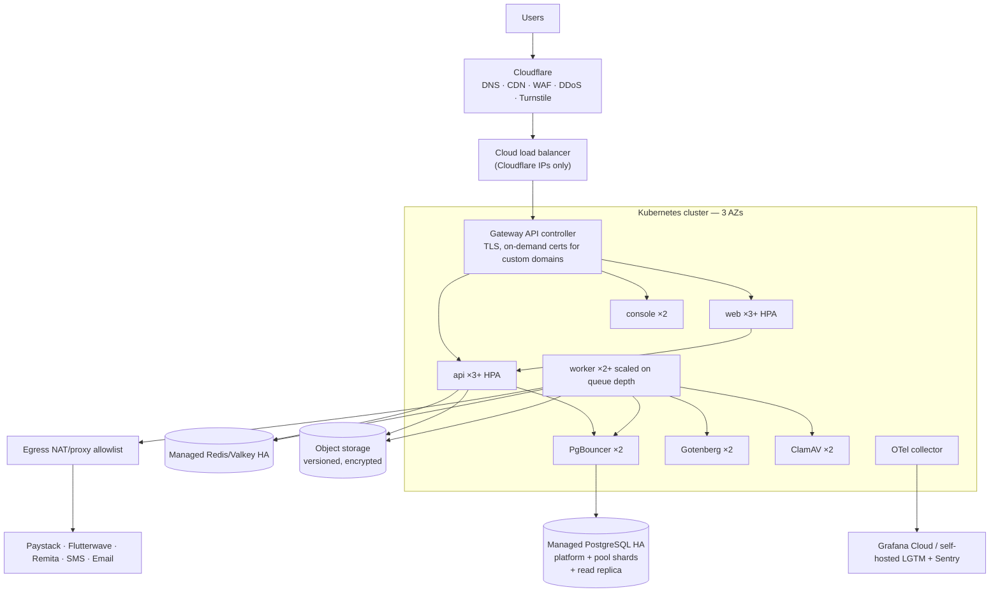

# 10 — Infrastructure & Deployment

## 1. Environments

| Env | Purpose | Hosting | Data | Deploys |
|-----|---------|---------|------|---------|
| **local** | Development | Docker Compose on the dev machine (`infra/compose/compose.dev.yml`) + apps via `pnpm dev` | Seed data | — |
| **ci** | Automated tests | Ephemeral compose / Testcontainers in CI runners | Seed + fixtures | Every push |
| **preview** (optional, later) | Per-PR review | Ephemeral namespace | Seed | Per PR |
| **staging** | Pre-prod verification, pilots' UAT, DAST, load tests | Same topology as prod, smaller | Synthetic/anonymised only | Auto on merge to `main` |
| **production** | Live tenants | Managed cloud, multi-AZ | Real | Tagged releases, manual approval |

Environments are isolated from each other: separate cloud accounts/projects (at minimum separate VPCs + IAM), separate secrets, separate registries or registry paths with pull-only credentials.

## 2. Hosting strategy by stage

| Stage | Topology | Why |
|-------|----------|-----|
| Phases 0–2 (build) | Local compose + a single **staging VM** running hardened compose ([09 §4.2](09-container-security.md)) with managed Postgres | Cheap, simple, fast feedback |
| Phases 3–6 (pilot, 1–3 tenants) | **Managed Kubernetes** (small, 3 nodes across AZs) + managed Postgres (HA) + managed Redis + object storage + Cloudflare | HA for real users, the deploy pipeline is exercised before GA |
| GA and growth | Same, with autoscaling, a read replica, more pool shards, dedicated shards for large tenants | Scales horizontally without re-architecture |

**Region choice** `[VERIFY]` with pilot institutions and the NDPA transfer rules ([16](16-compliance-ndpa.md)):
- Option A: AWS `af-south-1` (Cape Town) + Lagos Local Zone / Azure South Africa North. Low latency, mature managed services. Needs a cross-border transfer basis under NDPA.
- Option B: Nigerian data centre/cloud (e.g. Rack Centre, MainOne/Equinix LG, local clouds). Data stays in-country, but managed services are less mature.
- Recommendation: Option A for GA, with a documented transfer basis and DPAs. Keep the architecture cloud-portable (Kubernetes, Postgres, S3 API, Terraform modules per provider) so a tenant that requires in-country hosting can get a **dedicated deployment**.

## 3. Production topology



## 4. Local development

> **Current state:** see [ADR-015](19-decision-log.md). Postgres runs natively in Phase 0, and dependencies are added to compose as features need them. The list below is the target.

`infra/compose/compose.dev.yml` provides: `postgres` (with `platform` + `pool_01` DBs, roles and extensions via init scripts), `valkey`, `seaweedfs` S3 gateway (+ bucket bootstrap; [ADR-025](19-decision-log.md)), `mailpit` (catches email), `gotenberg`, `clamav`, and an optional `caddy` for `*.univarse.localhost` subdomains.

**PgBouncer** ([spec 0017](specs/0017-pgbouncer-isolation.md)) isn't in compose. `tools/pgbouncer/run.mjs` runs it, the same script CI uses:

- **The image:** `infra/docker/pgbouncer.Dockerfile`, PgBouncer built from the verified upstream source on distroless. It is gated by Trivy, a CPE inventory and Grype (CI job `pgbouncer-image`, [09 §2.3](09-container-security.md)).
- **Its configuration:** `pnpm db:setup` writes the git-ignored `.pgbouncer/`:
  - the owner-only auth file;
  - two profiles that differ only in `default_pool_size`: **probe**, 2 (sharing and saturation made certain), and **suite**, 10 (matching each client's pool, [ADR-026](19-decision-log.md));
  - in both, `transaction` mode, `max_prepared_statements = 0`, `query_wait_timeout = 2`, `ignore_startup_parameters` unset, and `max_packet_size` at its default.
- **Running it:** `pnpm dev:pgbouncer <probe|suite>` starts it on `127.0.0.1:6432`. It runs read-only, with no capabilities, as a non-root user, with the `.pgbouncer` directory mounted read-only. `host.docker.internal` is mapped to the Docker daemon's discovered host-gateway **IPv4** address (`tools/pgbouncer/gateway.mjs`): on this machine's Docker Desktop, `host-gateway` also produced an unroutable IPv6 address.
- **Testing through it:** `pnpm test:int:pgbouncer` runs the probes and the three isolation suites through it.
- **Your own Postgres:** if native PostgreSQL refuses connections from Docker's address range, a `pg_hba.conf` entry for that range (scram, the app databases only) is the developer's own step.

```bash
pnpm i
pnpm dev:infra        # docker compose -f infra/compose/compose.dev.yml up -d
pnpm db:migrate       # platform + tenant schemas, RLS, grants
pnpm db:seed          # demo tenants: demo-uni, test-poly
pnpm dev              # turbo: web :3000, console :3001, api :8080, worker
```
Browse `http://demo-uni.univarse.localhost:3000`. `*.localhost` resolves to loopback in modern browsers, so no hosts-file edits are needed. Ports are bound to `127.0.0.1` only.

**Traces, optional and off by default ([spec 0012](specs/0012-observability-logs-and-traces.md) D2):**
- **Starting it:**
  - `pnpm dev:traces` starts the **OpenTelemetry Collector** (`otel/opentelemetry-collector-contrib:0.162.0`, compose profile `traces`).
  - It accepts OTLP/HTTP on `127.0.0.1:14318`. That's not 4318, so the no-endpoint test that guards the default port never sees it.
  - It writes JSON lines to `infra/compose/otel/out/traces.jsonl` (git-ignored, rotated at 50 MB × 2).
  - Run the API and worker with `OTEL_EXPORTER_OTLP_ENDPOINT=http://127.0.0.1:14318`.
- **Jaeger:** `pnpm dev:traces:jaeger` also starts **Jaeger** 2.22.0 (profile `jaeger`, in-memory storage) with its UI on `http://127.0.0.1:16686`. This is for local viewing only; CI and deployments never run it.
- **Memory:**
  - **The collector:** limited to 256 MB (`mem_limit`, plus a `memory_limiter` at 200 MiB). It measured **57 MiB** after about 2,200 spans (2026-10-07).
  - **Jaeger:** limited to 512 MB.
  - **On the 8 GB laptop,** start these only when you're looking at traces, and stop them after (`docker compose … stop otel-collector jaeger`), as with ClamAV.
- **CI:** the OB12 step starts the same collector service.

### 4.1 Local resource budget (measured 2026-10-06, spec 0010 FU12; database connections 2026-10-07, ADR-026)
**What was measured:**
- **Stack:** Valkey, Mailpit, Vault, SeaweedFS 4.48 and ClamAV 1.5.4 (fail-closed settings) in Docker; the API and worker on the host.
- **Load:** 12 uploads (four of 4.5 MB) scanned while clean files were downloaded concurrently, with a ClamAV signature `RELOAD` triggered mid-burst. The opt-in test is `apps/api/src/modules/files/files.load.int.spec.ts`.

| Container | Idle | Peak, three runs (3rd on `main` at `3aaf809`) |
|---|---|---|
| ClamAV | 955 MiB | **1,579 / 1,907 / 1,371 MiB** (the reload briefly holds two databases) |
| SeaweedFS | 73 MiB | 380 / 413 / 445 MiB |
| Vault, Valkey, Mailpit | ~60 MiB together | ~70 / ~70 / 76 MiB together |
| **All containers** | ~1.1 GiB | **2,025 / 2,395 / 1,893 MiB** |
| API and worker process (host) | | ~390 / ~390 / 344 MiB |

**In all three runs** (per-run table in spec 0010's completion record):
- **0 container restarts** and **0 failed downloads** (161, 87 and 126 completed);
- all 12 files ended `CLEAN`;
- in run two, 3 scans were **retried** while clamd was reloading. A busy scanner delays files; it never releases them.

**Recommendation:**
- **Docker:** allocate **at least 4 GB**. The highest observed container peak for this workload is 2,395 MiB, plus headroom; 3.8 GB worked here.
- **That figure is not a server size.** It covers one workload of the dev containers. A server's RAM also covers Postgres, the OS, more API and worker instances, and real traffic; it is sized in spec 0008.
- **ClamAV in staging and production:** a **2.5–3 GB** memory limit for its container. Its own guidance of about 4 GB stays the safer default for production nodes.
- These figures replace the earlier "8 GB" estimate.

**Bandwidth:**
- The ClamAV image ships with signatures, but **FreshClam still downloads updates** at start and daily (usually small diffs, sometimes a full database). Observed here: signatures 28136 (2026-09-27) updated to 28144 (2026-10-05) on first start. Image size is not a total download budget.
- `CLAMAV_NO_FRESHCLAMD=true` in `.env` stops updates on a slow link. That is local only, with stale signatures, and never in CI or deployed environments.

**Database connection capacity (measured 2026-10-07, [ADR-026](19-decision-log.md)):**
- **Why:** the OB8 test (`tracing.int.spec.ts`) sent 24 concurrent authenticated `GET /api/v1/files` requests. With spans exported synchronously, some returned 500 with P2028: Prisma's 2 s transaction wait expired while session authentication waited for a connection.
- **Machine:** the dev laptop, an i7-7500U (2 cores, 4 threads) with 8 GB RAM. Before the test it already ran at 100% CPU with 0.9 GB free (IDEs, browsers, the Docker VM). Postgres 18.1 native, one compiled API process (`dist/main.js`). These are a loaded machine's numbers, not a server's.
- **Load:** `apps/api/scripts/load/session-auth.mjs`. Closed loop, 10 s per step, authenticated `GET /api/v1/files`, half `demo-uni` and half `test-poly`, both on `univarse_pool_01`. Each request runs two shard transactions: authentication and the list. "Tracing" means `--import ./dist/otel.js` exporting by batch to a local discard sink.

| Configuration | First step with P2028 (of 16 → 128 concurrent) | Throughput | p95 at 64 concurrent |
|---|---|---|---|
| Pool 10, wait 2 s, no tracing (two runs) | **128** (23 of 521 requests) / none | 32–70 req/s | 2.2–2.4 s |
| Pool 10, wait 2 s, tracing (two runs) | **64** (102 failed) / **32** (17 failed) | 10–45 req/s | 4.4–8.0 s |
| Pool 20, wait 2 s, no tracing / tracing | **16** / **16** | 14–61 / 10–39 req/s | 3.5 / 4.3 s |
| Pool 10, wait 5 s, no tracing / tracing | none / none | 23–64 / 34–72 req/s | 3.9 / 1.6 s |

**What it shows:**
- **The ceiling is the machine, not the pool.** Throughput stays flat as concurrency rises, whatever the settings, and the API process used only about 0.5 cores. A tenant transaction holds its connection about 9–15 ms through Prisma, against 2.7 ms for the same statements over raw `pg`; on a starved CPU every hop between statements grows. Tracing roughly halves throughput here, so P2028 starts 2–4× sooner.
- **A bigger pool fails sooner.** The extra connections are opened under load, inside the 2 s wait. It also raised pg's own "connection timeout" errors.
- **A longer wait only hides the queue.** No refusals, but p95 of 2–4 s with no more throughput. The run-to-run spread (the 5 s/tracing row beat the 2 s/no-tracing rows) is this machine's noise.
- **Session authentication isn't the special case.** About 70% of the P2028s came from the list's batch transaction. Every transaction on a shard shares the same queue.

**Decision ([ADR-026](19-decision-log.md)):** keep 10 connections and the 2 s wait, now explicit. Shed the overflow as **503 `server.busy` + `Retry-After`** instead of a 500 (see [07 §2](07-data-and-database.md)). Add capacity with API replicas and shard resources ([§6](#6-scaling)). Repeat this measurement on the staging hardware before pilot. Its numbers, not these, size the replicas and PgBouncer.

### 4.2 The local production-like stack ([spec 0019](specs/0019-local-production-stack.md), [ADR-030](19-decision-log.md))

The release's verified images, run as production would run them, on this machine. It is separate from `pnpm dev`: its own PostgreSQL 18, Vault, Valkey, SeaweedFS and Mailpit, its own secrets, and no use of the root `.env`.

```bash
pnpm stack:init                              # once: secrets, the stack CA and the edge CA in ~/.univarse/stack (owner-only)
pnpm stack:trust                             # the edge CA's fingerprint, and how to install (and remove) it: your step
pnpm stack:deploy releases/<record>.json     # verify the record, then migrate, recover the shred ledger, start and smoke-check
pnpm stack:deploy <record> --init-ledger    # once, the first deploy with spec 0020: creates the shred ledger
pnpm stack:vault unseal                      # after a restart (the deploy says when)
pnpm stack:vault renew                       # both Vault tokens back to their full 32 days (the deploy and the services also do it)
pnpm stack:smoke                             # the smoke check again, on the running stack
pnpm stack:pools                             # PgBouncer's SHOW POOLS, from inside the stack
pnpm stack:isolation                         # spec 0017's PB1 and PB2 through the stack's PgBouncer
pnpm stack:e2e                               # the Playwright suite against the stack over HTTPS
pnpm stack:keys destroy <tenant> [--version <n>]   # the only way keys are destroyed in the stack (spec 0020)
pnpm stack:keys recover                      # the ledger's recovery (every deploy runs it)
pnpm stack:keys ledger status                # the ledger's destinations and destructions
pnpm stack:keys ledger waive --reason "…" --confirm "destroyed tenants may return" --destination <path>…   # only when no destination can be read
pnpm stack:vault migrate-raft releases/<record>.json [--commit <full 40-character sha>]   # once, spec 0020 B1: Vault from file storage to Raft
pnpm stack:backup keygen --out <offline path>  # once: the backup key pair; the private half stays offline
pnpm stack:backup destination <path>         # where sets go (default ~/.univarse/backups)
pnpm stack:backup                            # one sealed set, then pruning (spec 0020 D2–D6)
pnpm stack:backup wal                        # ship the WAL staged since the last run
pnpm stack:backup status                     # the newest set, the erasure boundary, WAL, the schedule (no key needed)
pnpm stack:backup schedule --at 13:30        # prints the two scheduled tasks; again with --apply registers them (Windows)
pnpm stack:backup schedule --remove          # unregisters them
pnpm stack:down                              # stop it; volumes are kept
```

- **The address:** `https://demo-uni.stack.univarse.localhost` (Caddy on `127.0.0.1:443`; `:80` only redirects). Mailpit is at `https://mail.stack.univarse.localhost`.
- **Trust:** the certificate comes from UniVarse's own edge CA, which can vouch only for `stack.univarse.localhost` and its subdomains. Install it in your user's trust store after checking its fingerprint (`pnpm stack:trust` prints the commands, including removal). Chrome and Edge use that store; Firefox keeps its own. Verification is never disabled.
- **Tests against the stack:** `stack:e2e` and `stack:isolation` open a temporary tunnel that publishes PgBouncer (never PostgreSQL) on `127.0.0.1:16432` for the run only, with TLS and passwords still required. It is removed afterwards, even after a failure, and checked gone. Their settings come from `~/.univarse/stack`, never the root `.env`.
- **The deploy only runs verified digests.** It holds the registry lock throughout, and it verifies the record with the committed public key before anything is created. A rejected record starts nothing.
- **Networks:**
  - only Caddy publishes a port;
  - `app` and `db` are internal;
  - PostgreSQL is on `db` with only PgBouncer and the migrate job;
  - the API and worker reach the database only through PgBouncer, over TLS verified against the stack CA.
- **Memory:** the limits sum to at most 3.5 GB without ClamAV (`--profile scan`). Idle it uses about 0.6 GB (spec 0019's notes).
- **Vault** listens only with TLS (the stack CA's certificate) and logs every request to its audit volume, values HMAC'd. If the audit log can't be written, Vault refuses requests and the app fails closed. A changed Vault certificate (after `stack:init --rotate`) restarts Vault, which comes back sealed: the deploy then asks for `pnpm stack:vault unseal`. So does a reboot of this machine. The smoke check names a sealed Vault first.
- **Vault's two tokens** ([spec 0023](specs/0023-vault-app-token-renewal.md)):
  - the app's, for Transit, and the backup's, for Raft snapshots;
  - each periodic at 32 days, and kept alive by renewal: the API and the worker renew theirs every 6 hours, the backup renews its own at each run, and every deploy renews both;
  - a token Vault says is dead is re-issued by the next deploy, which then recreates the API and the worker;
  - `stack:smoke` and `stack:backup status` show each token's remaining life, and the smoke check fails under 7 days.
- **The shred ledger** ([spec 0020](specs/0020-local-backups-and-shred-ledger.md) D7, D8) lives outside the stack, in `~/.univarse/ledger/`, plus every destination you add (`pnpm stack:keys ledger add-destination <path>`: an external drive is recommended, since only it survives the loss of this disk). A destruction is accepted only once its records are durable on every destination. Every deploy runs its recovery after the migrate job, before the API and worker start: a destruction a restore undid is made again, and anything it can't decide stops the deploy. With a destination unreadable, nothing restarts until you reconnect it, rebuild it (`ledger rebuild-destination`) or remove it (`ledger remove-destination`). The stack's `uv-shred-ledger` bucket keeps an object-locked copy of every entry for 10 years, as evidence only, never relied on. **If no destination can be read at all,** only `ledger waive` lets the stack run again: it records that the no-resurrection guarantee is waived for every destruction before that moment, re-applies every destruction it can still find (in any surviving copy, `--from` copies, the bucket and the database), and starts a new generation on the destinations you name, guaranteed from then on. Every deploy, `recover`, `ledger status` and `stack:smoke` then report "no-resurrection guarantee waived since <time>" for as long as that generation is the ledger.
- **Backups** ([spec 0020](specs/0020-local-backups-and-shred-ledger.md) PR B1). `pnpm stack:backup` writes a *set* to the backup destination:
  - **What is in a set:** PostgreSQL (`pg_basebackup`, with the WAL it needs), Vault's Raft snapshot, the clean bucket's files, the parts of `~/.univarse/stack` a restore needs, a copy of the shred ledger, and a manifest.
  - **Sealing:** each artifact is sealed as it streams to the owner's backup public key (`infra/backup/backup.pub`), so no unsealed copy touches the disk. The private key exists only offline, encrypted with its passphrase, and every restore needs it. A lost private key makes every backup unreadable, so keep two copies, as with the signing key.
  - **The index:** a clear `index.json` names the files, their hashes and the WAL the set needs, and nothing else. It is written last, and a set without it is incomplete and ignored.
  - **The order and the locks:** the backup holds the registry lock. It takes the ledger lock only while it copies the ledger, which must establish its authority first, as recovery does.
  - **Pruning:** every backup ends by pruning. It keeps the 7 newest sets plus the newest set of each of the 4 ISO weeks before them, and the WAL from the oldest kept set on.
  - **WAL:** PostgreSQL archives each finished segment into the staging volume `univarse-stack-pg-wal-staging`, within 5 minutes of a write. `pnpm stack:backup wal` (every 15 minutes, by the schedule below) seals and ships the segments, and removes each staged copy only once it is durable at the destination. The local RPO is about 20 minutes while the machine runs. A segment not yet shipped is inside the stack, and is lost with it.
  - **Vault on Raft:** a running Vault can now be snapshotted consistently. A stack on the old file storage is migrated once with `pnpm stack:vault migrate-raft <record>`, which verifies the KEK, a probe and every data key before it records the migration. The deploy refuses until then. The old file storage (`univarse-stack_vault-data`) is never written and is kept, so going back means deploying the previous release from its own commit. Deleting it is a separate owner step, once the owner chooses. The snapshot uses a token whose policy reads snapshots and nothing else.
  - **An external drive:** when the destination is on another drive than the ledger's primary, that drive must hold a ledger destination too (`pnpm stack:keys ledger add-destination`). Otherwise the backup refuses.
  - **Same-disk limit:** a set on this disk survives a broken stack, a bad migration or a mistake, but not the loss of the disk. Only a copy on separate media does.
  - **The schedule** ([spec 0020](specs/0020-local-backups-and-shred-ledger.md) B2-4): `pnpm stack:backup schedule --at <HH:MM>` prints two Windows scheduled tasks, in the `\UniVarse\` folder, and changes nothing. With `--apply` it registers them:
    - `backup`, daily at that local time;
    - `backup-wal`, every 15 minutes.

    How they run:
    - as you, only while you're logged on (Docker Desktop runs in your session, and the alternative stores your Windows password);
    - a run missed while the machine slept runs when it wakes, and neither task wakes the machine;
    - with node's and pnpm's paths from when you scheduled them, in this checkout. **They run whatever this checkout holds**, so a branch left checked out is what runs;
    - a backup that finds a deploy or a release holding the registry lock waits for it, up to an hour;
    - each run appends what it prints to `~/.univarse/stack/logs/backup-YYYY-MM-DD.log` (owner-only), and logs older than 30 days are removed.

    Elsewhere than Windows, the command prints the equivalent crontab lines and registers nothing.
  - **Status:** `pnpm stack:backup status` needs no private key. It shows the newest set and its age, the **actual erasure boundary** (the age of the oldest set still kept), the newest shipped and oldest staged WAL, the tasks' last runs, D7's external-drive rule and any waiver. It marks with `WARN`:
    - a newest set over 26 hours old, or none;
    - WAL staged for over an hour;
    - a task not registered, or whose last run failed;
    - the external rule not holding.

    It exits 1 only when something can't be read. Every deploy that passes prints the same warnings at its end; they never block it.
  - **Restore:** the rehearsed restore and the shred drill come with PR B2b.
- **Secrets** live only in `~/.univarse/stack/`: `secrets.json`, `vault-init.json` (Vault's unseal key and root token), `certs/` (the stack CA's key), `edge/` (the edge CA's key) and the rendered env files. `pnpm stack:init --rotate` replaces the secrets and internal certificates, and the next deploy applies them, restarting each service whose files changed. The edge CA changes only with `--rotate-edge`, after which it must be installed again. A PostgreSQL superuser password is fixed when the database volume is first created, so after rotating it, reset `univarse-stack_pgdata` (the stack's data is demo data).

## 5. Deployment process

1. Merge to `main` → CI builds, tests, scans, signs images → **staging deploy** (Helm upgrade, digests pinned) → migration job → smoke tests → e2e subset.
2. Release: tag `vX.Y.Z` → release notes → **manual approval** → prod pipeline:
   1. `MigrationRun` job (expand-phase migrations only; see [07 §4](07-data-and-database.md)) across shards. Stop on failure.
   2. Rolling update (maxUnavailable 0, maxSurge 25%), readiness-gated.
   3. Post-deploy smoke tests (login per tenant type, health, a read on each module).
   4. Automatic rollback (`helm rollback`) if smoke tests fail or the error-rate SLO burns fast in the first 15 min.
3. **Deploy windows:** avoid deploys during tenant-critical windows (registration closing days, result publication days). Tenants' calendar windows are visible to the release checklist. Emergency security fixes are exempt.
4. **Feature flags** decouple deploy from release for risky features and per-tenant rollouts.

## 6. Scaling

| Component | Scaling signal | Limits |
|-----------|---------------|--------|
| web | CPU 60% / RPS | min 3, max 20 |
| api | CPU 60% + p95 latency + `server.busy` (503) rate ([ADR-026](19-decision-log.md)) | min 3, max 30. 10 connections per shard per replica |
| worker | BullMQ queue depth & age (KEDA) | min 2, max 20. Per-queue concurrency caps |
| PgBouncer | Connections | `default_pool_size` tuned so Σ pools < Postgres `max_connections` × 0.8 |
| Postgres | CPU, IOPS, connections | Vertical first. Read replica for reporting. New pool shard at ~50 tenants / 500 GB / sustained CPU > 60% |
| Redis | Memory, ops/s | HA primary/replica. Separate instance for queues if contention appears |

**Pre-scaling for known peaks.** Tenants' result publication and registration-deadline dates come from `CalendarWindow`. The ops calendar pre-scales min replicas the day before (a scheduled job adjusts HPA minimums).

## 7. Backup & disaster recovery

| Item | Method | Frequency / retention |
|------|--------|-----------------------|
| Postgres (all DBs) | Managed PITR (WAL) | Continuous; 35 days prod, 7 days staging |
| Postgres snapshots | Provider snapshot, **copied cross-region**, encrypted. Platform-DB snapshots hold wrapped tenant keys, so this retention sets the crypto-erasure boundary (up to 12 months, [spec 0006](specs/0006-envelope-encryption.md)) | Daily; 35 days, monthly kept 12 months |
| Per-tenant logical export | Worker job: `COPY … WHERE tenant_id = $1` for all tables **except `tenant_data_key`** (wrapped keys never go into object-locked archives, [spec 0006](specs/0006-envelope-encryption.md) destruction boundary) → encrypted archive → backup bucket (different account, object lock) | Nightly; 30 days, monthly 12 months |
| Object storage | Versioning + cross-region replication + object lock (compliance mode) on the backup bucket | Continuous |
| Redis | Not a system of record (sessions are re-creatable; queues rebuilt from outbox) | AOF for durability of in-flight jobs |
| Secrets / config | Secret manager versioning. IaC in git | — |

**Targets:** RPO ≤ **15 min** (PITR typically gives < 5), RTO ≤ **4 h** for full-region loss, ≤ **1 h** for a single-tenant logical restore.

**Drills:**
- Quarterly: restore the prod snapshot into an isolated environment, run the verification suite, record the timings.
- Semi-annually: a single-tenant restore rehearsal and a region-failover tabletop.
- Drill results are logged in `docs/ops/drills/`.

## 8. Networking & DNS

- DNS is on Cloudflare. `*.univarse.ng` → edge. `console.univarse.ng` has a Cloudflare Access / IP allowlist rule. `api.univarse.ng` is for webhooks only.
- Custom domains: the tenant creates a CNAME to `edge.univarse.ng` + a TXT verification record. The gateway issues on-demand TLS **only** for hostnames present and verified in `TenantDomain` (`ask` endpoint check).
- The origin accepts traffic **only from Cloudflare IP ranges** (or via Cloudflare Tunnel). Authenticated origin pulls (mTLS between Cloudflare and the origin) are enabled.
- Private subnets for the cluster and data services. Only the load balancer is public.

## 9. Cost awareness (pilot scale, indicative)

Keep a monthly cost dashboard per environment. The biggest levers are managed Postgres size, NAT/egress, log volume (sample debug logs, keep the info level lean) and SMS (charged per tenant). Review before each phase.

## 10. Operational documents to maintain (`docs/ops/`)

- `runbooks/*.md` (see [14 §6](14-observability-and-operations.md))
- `drills/YYYY-MM-*.md`
- `oncall.md` (rota, escalation, contacts)
- `release-checklist.md`
- `tenant-onboarding-checklist.md`
- `tenant-offboarding-checklist.md`
