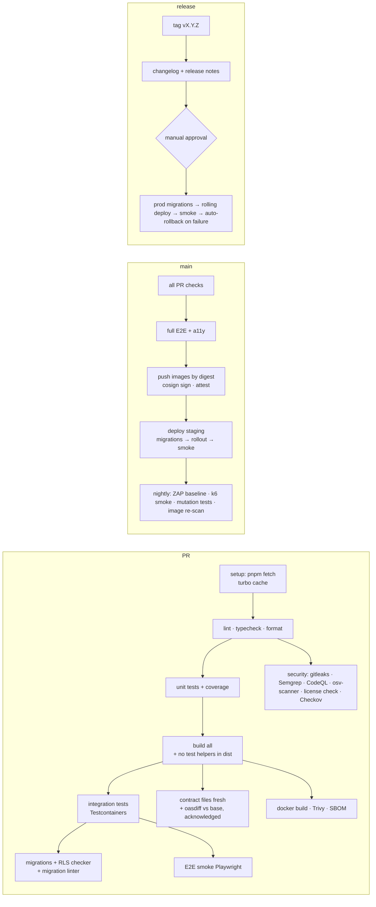

# 13 — CI/CD & Development Workflow

## 1. Source control

- **Git from day one.** Hosted on GitHub (private), `main` protected.
- **Trunk-based development:** short-lived branches (`feat/results-approval-flow`, `fix/gpa-rounding`, `chore/…`, `docs/…`, `sec/…`), merged within ~1–3 days. Big features hide behind feature flags rather than living on long branches.
- **Branch protection on `main`:** PR required, all status checks green, linear history (squash merge), signed commits (SSH/GPG) required, no force pushes, CODEOWNERS for `packages/domain`, `packages/db`, `infra/`, `docs/08*`, `docs/09*`.
- **Commits:** Conventional Commits (`feat(results): add HOD return action`). A commitlint hook enforces them. Scope = module name.
- **PR template** (`.github/pull_request_template.md`) includes: summary, linked roadmap item, screenshots, checklists from [08 §13](08-security.md) and [12 §8](12-testing-strategy.md), migration notes, rollback notes, and the API breaking changes section.
- **API breaking changes** ([spec 0011](specs/0011-openapi-and-api-client.md) D4, report-only):
  - The `api-contract` workflow runs oasdiff on the PR's `openapi.json` against the base branch and writes every change to the job summary.
  - **When it fails:** only when a breaking change (oasdiff level ERR) isn't acknowledged in the PR description.
  - **What counts as acknowledged:** an `## API breaking changes` section that names each broken operation as `METHOD /path`, plus an `Open tabs:` line saying how a browser tab still running the previous web app copes. First-party clients can stay open across a deploy; the usual answer is expand → migrate → contract.
  - **Re-evaluation:** the check re-runs when the description is edited.
  - **Enforcement:** `api-breaking-changes` is a required status check in the `protect-main` ruleset, together with `build-test` and `secrets-scan`.
- **Review:** solo phase: self-review + AI review (`/code-review`) + CI. Every change to auth, RLS, payments or results engines gets a deliberate second pass the next day ("sleep on it" rule) or a second reviewer once the team grows.

## 2. Local quality gates (lefthook)

Built by [spec 0024](specs/0024-ci-security-gates.md) PR B (`lefthook.yml`). `pnpm install` installs the hooks, except in CI, outside a git checkout, and where lefthook isn't installed. They are a convenience: `--no-verify` still works, and CI is the gate.

- **pre-commit:** `gitleaks git --staged`, with the pinned, checksum-verified gitleaks from `pnpm tools:gitleaks` (CI's version). Without it, the commit is refused, saying how to get it.
- **commit-msg:** the first line is held to G10, `type(scope): description`, by the same code as CI's PR-title check (`tools/security/pr-title.mjs`). Git's own merge, revert and fixup messages pass.
- **pre-push:** ESLint on the pushed files, and `turbo run typecheck --affected`.
- **A commit stays under 10 s** (2–4 s measured). ESLint's typed rules and the type check each take 10 s or more to start on the owner's machine, so they run before a push instead.
- **Not yet:** Prettier. The repository isn't formatted yet; one formatting-only PR (spec 0024 H3, the owner's call) comes first.

## 3. CI pipeline (GitHub Actions)

- **Images ([spec 0013](specs/0013-container-images-scan-sign.md), [ADR-030](19-decision-log.md)):**
  - **In CI:** the read-only `build-test` job builds the API/worker and web images once. It verifies the base image's upstream signature, inspects the images, runs the Trivy gates (zero HIGH/CRITICAL, fixed or not; secrets; misconfiguration), produces SBOMs, and runs the hardened smoke run and the browser journeys against the containers.
  - **No push or sign in CI:** there's no CI job with `packages`, `id-token` or `attestations` write.
  - **Signing and publication are local:** they happen through `pnpm images:release`, against a local registry, with the owner's key.
- **Turborepo remote cache** keeps PR CI under ~10 min. Affected-only execution for lint/test on large changes.
- **Workflow policy ([spec 0013](specs/0013-container-images-scan-sign.md) CS12):** `build-test` checks every workflow, read-only, with `pnpm ci:policy`. CI stays `contents: read`, and only allowlisted triggers are used; `pull_request_target` and `workflow_run` are banned. No credentials and no publish or sign commands are allowed where PR code runs, and actions are pinned by SHA. Fixtures prove each rule.
- **Required checks** block merge: lint, typecheck, unit, integration, RLS, contract diff (unless labelled `breaking-approved`), security scans, Trivy, E2E smoke.
- **The security scans ([spec 0024](specs/0024-ci-security-gates.md))** are two jobs, beside `build-test`:
  - **`security-scans`:**
    - Semgrep, where `ERROR` blocks;
    - osv-scanner, where any known vulnerability blocks;
    - the license check, where a production dependency outside the allowlist blocks;
    - Checkov, on the Dockerfiles and workflows, where any failed check blocks;
    - the PR-title check;
    - each gate's proof.
  - **`codeql`:** `security-extended`, where errors and warnings block. It runs read-only, with no upload: the SARIF is kept as a run artifact.
  - **Each gate blocks on the whole tree, not only on new findings.** An exception is one of three kinds, checked by `tools/security/exceptions.mjs` before any scan:
    - in `osv-scanner.toml`, expiring within 30 days;
    - in `infra/security/license-exceptions.yaml`, expiring within 365 days;
    - inline, naming its rule and giving its reason (`nosemgrep: <rule> -- <reason>`, `checkov:skip=<id>: <reason>`, and `codeql[<rule>]: <reason>` on the line above a CodeQL result).
  - **Every active exception is printed on every run.**
- **CI security:**
  - Actions pinned by commit SHA
  - `permissions: read-all` default, elevated per job
  - OIDC to cloud (no static keys)
  - environment protection rules for `staging`/`production`
  - secrets scoped to environments
  - no secrets exposed to fork PRs
  - Dependabot for action updates (`.github/dependabot.yml`, weekly)

## 4. Versioning & releases

- **SemVer** for the product. `CHANGELOG.md` generated from conventional commits (release-please).
- Release cadence: every 2 weeks during build phases. Weekly after GA, plus hotfixes as needed.
- **Hotfix:** branch from `main`, fix + test, fast-track the pipeline (the same gates apply; only the approval wait is shortened).
- **Release notes for tenants:** a user-facing summary per release in the console and an in-app "What's new". Breaking changes to tenant workflows are announced ≥ 2 weeks ahead.

## 5. Database changes in the pipeline

1. PR: the migration is generated, reviewed and linted (Squawk). The RLS checker runs on a fresh DB. Staging-size migration timing is estimated for big tables.
2. Merge: staging migrations run automatically before the rollout.
3. Release: prod `MigrationRun` across shards. The rollout proceeds only when every shard succeeds.
4. Contract-phase (destructive) migrations ship in a **later** release than the code that stopped using the old structure.

## 6. Environments & config promotion

- The same image digest is promoted from staging to prod. **Never rebuild for prod.**
- Config differences live only in Helm values per environment + secret manager entries. All env vars are validated at boot by a zod schema.
- Feature flags default **off** in prod for new features. They're enabled per pilot tenant first.

## 7. Work management

- Roadmap phases ([18](18-roadmap.md)) → epics per module → issues with acceptance criteria copied from [05](05-modules-and-features.md).
- Labels: `module:*`, `type:{feat,bug,chore,sec,docs}`, `priority:{p0..p3}`, `phase:*`, `needs-adr`.
- Every issue that touches a business rule links the rule section in [04](04-business-rules.md) and the relevant fixture.

## 8. Working with Claude Code on this repo

- `CLAUDE.md` at the repo root (from [templates/CLAUDE.md](templates/CLAUDE.md)) tells the agent the invariants, commands and where the docs are.
- Work in **vertical slices**: contract → migration → domain → use case → API → UI → tests, one feature at a time. Ask for a plan (plan mode) before multi-module changes.
- Use `/code-review` before merging and `/security-review` on auth/payment/results/RLS changes.
- Use a git worktree per parallel task to keep changes isolated.
- Keep the docs in the loop: if the implementation reveals a rule is wrong, update [04](04-business-rules.md) and the fixtures in the same PR.

### 8.1 The owner's standing rules

Carried over from the Phase 0 handoff, which was retired when Phase 0 closed.

- **Plan first.** Write the design and its decisions, with alternatives and why, in the spec, and review it adversarially before building. The owner approves decisions; they don't hunt bugs.
- **Review after.** Review the diff adversarially and mutation-check every test: each mutation must turn a test red, and a survivor gets its own test. Report a short list of decisions made while building, for approval.
- **Judge every run by its exit code,** not its pass count, and explain every error line before calling a run green.
- **Evidence:** integration and E2E evidence comes from CI when the environment lacks the services. Say what ran where, and never claim a run that didn't happen.
- **Merging:** only on the owner's explicit go-ahead, after green CI on the exact final head: `gh pr merge N --squash --match-head-commit <full sha>`. Re-verify the checks after any edit to the PR, since editing a PR body can re-run them.
- **Cleanup:** after merging, read `gh pr view N --json state` in a separate step, and only once it says `MERGED` delete the branches and worktree. Never chain cleanup into the merge command: a chained cleanup once closed #89.
- **Branches:** work on a branch in a worktree, never push to `main`, never force-push over others' work.
- **Secrets:**
  - never in code, logs, errors, URLs, fixtures or test output; test assertions never print credentials;
  - never handle the owner's PostgreSQL superuser password, the signing key or its password, or the backup private key or its passphrase;
  - `docs/brand-doc/` stays off GitHub.
- **Never run:** `db:setup` in the owner's main checkout, `docker volume prune`, or `images:prune --apply` without the owner's go-ahead. Don't change repo visibility or billing; no cloud accounts.
- **UI work:** load the design skills first (impeccable and the others in `.claude/skills`). Keep to the brand: deep green #485550; lime #C0EB6A, never as text on light surfaces; off-white #F4F6F0; Poppins. WCAG 2.2 AA, low-end Android on slow networks.

### 8.2 What only the owner does

Claude gives the exact commands; the owner runs them on their machine.

- **Releases:** `pnpm images:release`, signed with the owner's key (the owner sets `COSIGN_PASSWORD`). Before a release on the 8 GB machine: `pnpm stack:down`, stop the dev ClamAV, and check the dev Vault is unsealed.
- **The stack:** `pnpm stack:deploy releases/<record>.json`, `stack:keys …`, `stack:smoke`, `stack:bucket-check`, and unsealing Vault.
- **Backups:**
  - the backup key pair: the private half never leaves the owner and is never read;
  - the backup destination and the ledger's destinations;
  - the scheduled tasks;
  - the restore rehearsal and the shred drill, whose records go in `docs/ops/drills/`;
  - deleting old Vault storage or old key files.
- **GitHub:** required checks and branch protection, repo settings, and Dependabot dismissals.
