# 18 — Roadmap

Nine phases (plus Phase 4b, Teaching & Learning + CA CBT) from an empty repo to GA. Each phase ships **working, deployed, tested vertical slices**: backend + UI + tests + docs together. No module is "done" on mock data.

Sizes are rough effort estimates for **one developer working with AI assistance**. They're for sequencing, not promises. Re-estimate at each phase start.

```mermaid
gantt
  dateFormat  X
  axisFormat  %s
  section Build
  P0 Foundations            :p0, 0, 6
  P1 Platform control plane :p1, after p0, 4
  P2 Institution setup      :p2, after p1, 5
  P3 Admissions + Bursary   :p3, after p2, 8
  P4 Records + Registration :p4, after p3, 6
  P4b Teaching + CA CBT     :p4b, after p4, 7
  P4c UniVarse Live (media) :p4c, after p4b, 5
  P5 Exams + Results        :p5, after p4b, 8
  section Pilot
  Pilot tenant go-live (returning students) :milestone, after p5, 0
  P6 Graduation + Transcripts :p6, after p5, 6
  P7 Hostel, Comms, Helpdesk, Reporting :p7, after p6, 6
  P8 Hardening + GA         :p8, after p7, 5
```

*(Units are weeks. Total ≈ 61 weeks. Phases 6–8 overlap with pilot support. Because products are enabled independently (ADR-020), the pilot can go live on Core + Bursary + Academics even if Phase 4b slips. Results accept manually entered CA scores.)*

---

## Phase 0 — Foundations (~6 wks)

**Goal:** a secure, multi-tenant skeleton that every later module builds on.

- Monorepo (pnpm + Turborepo), shared configs, lefthook, commitlint, CI pipeline ([13](13-ci-cd-and-workflow.md)) with all security scans
- `compose.dev.yml` (Postgres 18, PgBouncer, Valkey, SeaweedFS ([ADR-025](19-decision-log.md); MinIO is unmaintained), Mailpit, Gotenberg, ClamAV)
- `packages/db`: platform + tenant Prisma schemas, roles/grants, **RLS template + checker**, `forTenant`, `withTenantTx`, API `ShardRegistry`
- API skeleton: NestJS/Fastify, config validation, tenant resolver, Problem Details filter, rate limiting, security headers, health endpoints, OTel + Pino, OpenAPI generation, `packages/api-client` generation
- **Identity:** users, argon2id, activation via OTP, login/logout, sessions (cookie), password reset, TOTP MFA, step-up, roles/permissions/scoped assignments, `PolicyService`
- **Audit** (hash chain), **outbox** + relay + BullMQ worker skeleton, **files** (presigned upload, ClamAV scan), **settings** module with typed keys
- Web skeleton: auth pages, workspace shell with permission-driven nav, design system in `packages/ui` with brand tokens, Storybook
- ~~Staging environment (single VM, hardened compose, managed Postgres)~~ → **local production-like stack** ([ADR-030](19-decision-log.md), 2026-10-12): hardened compose running the verified images by digest, local HTTPS, PgBouncer, Vault with TLS, local backups

**Exit criteria:**
- Two seeded tenants. The cross-tenant test suite passes (all 5 layers of [12 §3](12-testing-strategy.md))
- Login + MFA + step-up E2E green. CSP enforced over **local HTTPS** (ADR-030; was "on staging")
- Images signed, 0 high/critical findings. A **local deploy** runs only verified digests (ADR-030; was "staging deploy automatic from `main`")
- ADRs 001–012 accepted

**Fully local ([ADR-030](19-decision-log.md), 2026-10-12, owner decision):**
- **The change:** nothing is hosted or staged, and ADR-024's deferral of the staging criteria is superseded. There's **no deferred staging list**.
- **The criteria now:** each former staging criterion is a local one, and Phase 0 closes only when they're all met on the developer machine: HTTPS with CSP and `Secure` cookies, a local deploy of verified digests, PgBouncer, Vault with TLS and its audit device, and backups with a rehearsed restore.
- **Status:** Phase 0 is **not** closed yet; see the reconciliation below.

### Phase 0 reconciliation (2026-10-11, `main` at `0fe02f9`)

Each roadmap line checked against the repository, CI and the decision log.
- **Legend:**
  - ✅ **met**, with evidence;
  - 🟡 **partial**;
  - ❌ **not built**;
  - ⏸ **deferred** by a named ADR.
- **What counts as met:** CI-verified unless stated.
- **An ADR defers work; it doesn't satisfy the criterion.** Deferred items are listed separately below and stay unmet.

**Build items**

| Roadmap line | Status | Evidence / what's missing |
|---|---|---|
| Monorepo (pnpm + Turborepo), shared configs | ✅ | `turbo.json`, `tsconfig.base.json`, `eslint.config.mjs` (strict type-checked), `.prettierrc.json`, `.editorconfig` |
| lefthook, commitlint | ✅ | **Built by [spec 0024](specs/0024-ci-security-gates.md) PR B** ([13 §2](13-ci-cd-and-workflow.md)), installed by `pnpm install`: • pre-commit: gitleaks on the staged changes, pinned and checksum-verified; • commit-msg: the Conventional Commit check, by the same code as CI's PR-title check (it replaced commitlint, which took 4–5 s); • pre-push: ESLint on the pushed files and the affected typecheck. A commit takes 2–4 s. Prettier waits for the one formatting PR (H3, the owner's call). |
| CI pipeline ([13](13-ci-cd-and-workflow.md)) "with all security scans" | 🟡 | **In place:** build, typecheck, lint, unit, DB/crypto/API integration, migrations, RLS gate, seed twice, E2E desktop and mobile, OB12 compiled processes, contract freshness, `api-breaking-changes` (required), gitleaks, `pnpm audit --audit-level high`. **Built by [spec 0024](specs/0024-ci-security-gates.md) PR A:** • Semgrep, CodeQL (read-only, no upload), osv-scanner, the license check and Checkov, each blocking on the whole tree, with its proof; • the PR-title check; • Dependabot for the actions. Trivy, the SBOMs and signing came with [spec 0013](specs/0013-container-images-scan-sign.md). **Still to do:** the owner makes `security-scans` and `codeql` required checks. |
| `compose.dev.yml` services | 🟡 | **In compose:** Valkey, Mailpit, Vault, SeaweedFS ([ADR-025](19-decision-log.md)), ClamAV, Gotenberg (`docs` profile, which no feature uses yet), the OTel Collector and Jaeger (optional). **Postgres 18:** native on the host by [ADR-015](19-decision-log.md); CI uses `postgres:18`. **PgBouncer:** ✅ built from source on distroless, in transaction pooling ([spec 0017](specs/0017-pgbouncer-isolation.md)); the isolation suites run through it in CI (`pgbouncer-isolation`, `pgbouncer-compare`). |
| `packages/db`: schemas, roles/grants, RLS template + checker, `forTenant`, `withTenantTx`, `ShardRegistry` | ✅ | Platform and tenant Prisma schemas; `db:setup` least-privilege roles; `rls:check` with a negative control ([12 §3](12-testing-strategy.md) layer 1); `forTenant`/`withTenantTx` in `packages/db`; `ShardRegistry` in the API. Pool limits per [ADR-026](19-decision-log.md). |
| API skeleton: NestJS/Fastify, config validation, tenant resolver, Problem Details, rate limiting, security headers, health, OTel + Pino, OpenAPI, `api-client` | ✅ | Tenant from the Host; zod config at boot; Problem Details filter (503 `server.busy` per ADR-026); Valkey rate limits; security headers; `/health/live` and `/health/ready`. Logs and traces: [spec 0012](specs/0012-observability-logs-and-traces.md), complete. Contract and client: [spec 0011](specs/0011-openapi-and-api-client.md), complete. |
| Identity: users, argon2id, OTP activation, login/logout, cookie sessions, password reset, TOTP MFA, step-up | ✅ | Specs 0001 and 0005, ADR-016. MFA secrets under envelope encryption (spec 0006). Login, MFA and step-up E2E in CI. |
| Identity: roles/permissions **scoped assignments**, `PolicyService` | ✅ / ⏸ | Split by [ADR-028](19-decision-log.md): • **Institution scope: ✅ enforced.** Roles, the permission catalog and assignments are built. • **Central `PolicyService`: ✅** ([spec 0018](specs/0018-policy-service.md)): one pure `evaluate()` decides every permission; a static guard keeps every read of an actor's grants inside it; `role_assignment` has a CHECK tying `scope_id` to the scope. • **Negative tests: ✅** a matrix over every permission × scope type × MFA × step-up, and each of the five resource scopes refused end to end (`GET /users` 403, absent from `/auth/me`, `canManage` false). • **Resource scopes:** ⏸ deferred to each scope's first consuming module (`ORG_UNIT`, `PROGRAMME`, `COHORT`, `COURSE_OFFERING`, `HOSTEL`). **Not met.** |
| Audit (hash chain) | ✅ | Spec 0002 Part A. |
| Outbox + relay + **BullMQ** worker skeleton | ✅ / ⏸ | **Outbox:** a durable worker (claim with `SKIP LOCKED`, backoff, dead state, encrypted payloads; spec 0002 Part B), with request → delivery tracing (spec 0012 OB10). **BullMQ:** ⏸ deferred by [ADR-019](19-decision-log.md), with its revisit trigger recorded. |
| Files (presigned upload, ClamAV scan) | ✅ | [Spec 0010](specs/0010-file-uploads.md), against real SeaweedFS and ClamAV. |
| Settings module with typed keys | ✅ | Spec 0007: one key end to end, plus the registry. |
| Web: auth pages, workspace shell with permission-driven nav | ✅ | Spec 0005: login, MFA verify, activation, reset, MFA enrolment, the step-up dialog, and the workspace shell with gated nav (W6). E2E desktop and mobile in CI. A per-request nonce CSP is sent locally (`apps/web/src/proxy.ts`). |
| Web: design system in `packages/ui` with brand tokens | ✅ | `packages/ui` (`tokens.css`, components, icons). |
| Web: **Storybook** | ⏸ | Not installed. Deferred by [ADR-027](19-decision-log.md), to be revisited before Phase 2's UI expands. **Not met.** |
| Staging environment → **local production-like stack** | 🟡 | ADR-030, [spec 0019](specs/0019-local-production-stack.md). **Built:** • PR A (2026-10-20): hardened compose running the verified images by digest, with PgBouncer over TLS; • PR B (2026-10-21): the HTTPS edge with a name-constrained CA; • PR C1 (2026-10-21): Vault on TLS with its audit device, failing closed; • PR C2: production refuses a plaintext Vault. **Running** the release `f6abefa` (2026-10-22), which closed ADR-018. **Still to do:** local backups with a rehearsed restore (item 7.5): spec 0020 PR A (the shred ledger) is merged and deployed; PR B1 (Vault on Raft, WAL archiving, sealed sets; #103, #104) is merged and running, with Vault migrated and the first sealed set taken on 2026-10-24; PR B2a (status, the deploy's warnings, the schedule; #107) is merged; PR B2b (the rehearsed restore, the shred drill and the real restore) is built. **Closed only by the owner's drill record** (`pnpm stack:drill`, in `docs/ops/drills/`). |

**Exit criteria**

| Criterion | Status | Evidence / what's missing |
|---|---|---|
| Two seeded tenants | ✅ | `demo-uni`, `test-poly`; seeding runs twice in CI to prove it's idempotent. |
| Cross-tenant suite, all 5 layers of [12 §3](12-testing-strategy.md) | ✅ | **Layers 1–3:** ✅ (RLS checker, generic DB sweep, API route sweep: 30 real routes, 4 resource-by-id routes). **Layer 4 (jobs):** ✅ for today's jobs: the outbox worker (B8, B10; OB8), the file-scan worker and the key sweep ([spec 0014](specs/0014-job-isolation.md), JI1–JI7). **Layer 5 (caches/files):** ✅. Files are complete for the first slice. Products and key forget are on the invalidation bus: [spec 0015](specs/0015-cache-isolation.md) is complete for today's caches (2026-10-13; #66, head `b24fb4c`, merged as `b4df59d`; CI run `38450407103`). |
| Login + MFA + step-up E2E green | ✅ | Green in CI on every recent merge (32/32, desktop and mobile). A clean **local** run is a separate follow-up (cause measured; [spec 0012](specs/0012-observability-logs-and-traces.md)), not an extra exit requirement. |
| CSP enforced → **over local HTTPS** | ✅ | ADR-030, [spec 0019](specs/0019-local-production-stack.md) PR B (2026-10-21). Through `https://demo-uni.stack.univarse.localhost`: • the nonce CSP; • HSTS once at the edge, without `preload`; • the `__Host-` session cookie `Secure; HttpOnly; SameSite=Lax`; • the browser suite 34/34 against the stack, desktop and mobile, recording no CSP violation. |
| Images signed, 0 high/critical findings | ✅ | **Latest (2026-10-22):** the owner's release of `main` at `f6abefad63963b98a7c9cb89e4820e33a1d984f9` (spec 0019 C2). All four images were signed offline with the current key, with **0 HIGH/CRITICAL** and **no active exceptions**. Every gate passed, the smoke now including the plaintext-Vault refusal, and `pnpm images:verify` verified it independently in deploy mode: • API `sha256:9a32f9a359b10066c114cdbb7a5374b462b728010ef276fc065af67087010421` • web `sha256:82c5ea37d7ee36b0988550699f7ce8ab067133cfab09e108c26eeaa273cc693f` • migrate `sha256:9c94430765c72df8e67783665921121882d3b59d24c7b875cb5c7c817a02fd17` • PgBouncer `sha256:0fff3a9e3c3549ea5f9a241eaa6b069cedddf071b7c9b3d707c3dff61b0ad3f4` **Met again (2026-10-20)** by the owner's first four-image release (spec 0019), on `main` at `0cf53d88ea207b5c1b6af88e52390b10a1c92ced`, signed with the current key. All four images were signed offline, with **0 HIGH/CRITICAL** and **no active exceptions**. Every gate passed: inspection, misconfiguration, secrets with the canaries, PgBouncer's PB10 gates, the smoke, the migrate smoke and the journeys: • API `sha256:af11b58c301b6696c94cf5d8a1d180033b31e3d59c523343fc732143a32e4d0e` • web `sha256:c53bcfcb6ad651b65a942fa70ce910159b8e16883467357f450bf72cd5d5b517` • migrate `sha256:2ba12ba96147454f212e6e27e140cfa8c4d05e1e287db1783752437da9dc3b63` • PgBouncer `sha256:c27b9b0bb29df49da6ad8f00bba26259dc93ee16d383800fc60d9020f836b050` `pnpm images:verify` independently verified it in deploy mode. **History:** re-pending from the key rotation (2026-10-19): the password of the first signing key was lost, so the owner replaced the key, then replaced it again before it signed anything because its password was displayed in clear (`infra/signing/cosign.pub`, sha256 `48815009fd3c…`; [key history](../infra/signing/README.md#key-history)). The release below was signed with the old key and no longer verifies. **Met again** by the first four-image release (spec 0019) signed with the new key; the gates themselves were green on that build (2026-10-19). **Before the rotation:** [Spec 0013](specs/0013-container-images-scan-sign.md) LR10, 2026-10-12/13. **The release:** the owner's real-key local release on `main` at `12083b8ebe7362db3123a8d67a1b4c3b2a09907f`, signed with the key whose public half is `infra/signing/cosign.pub` (sha256 `386c0f55f82e60005a03526454cd287d10eb87534d4e829c1dd7e774900de194`). **Published:** API `sha256:8af794d21a95444fda06a876edfed514c1419e4a3ab146c02a8488fbbf5ed0db`, web `sha256:1d0c627d2b838d4f08538b272cea0aec918baca2b3e2b146327ef22d8667553f`. Both images were signed offline with the owner's key, with **0 HIGH/CRITICAL** findings (23 MEDIUM and 8 LOW, unfixed, from the base) and **no active exceptions**. **The deploy check:** `pnpm images:verify` independently verified both digests against `infra/signing/cosign.pub`. **Spec 0013 is closed** (2026-10-13; the CS16 completion record is in the spec). LR9's deploy integration is transferred to the local deploy (item 7.4) as a blocking criterion. The CS12 workflow-policy check is in CI. LR8 is met: the first reviewed `pnpm images:prune --apply` (2026-10-13) removed the rehearsals and left `12083b8` verifying independently, with all 164 of its blobs present. |
| Staging deploy → **local deploy of verified digests** | ✅ | ADR-030, [spec 0019](specs/0019-local-production-stack.md) PR A (2026-10-20). `pnpm stack:deploy` runs only digests verified with the committed public key, then smoke-checks the stack. LS3's tests cover six edited records, each starting nothing, and a held lock. The first real deploy ran `0cf53d8`'s four verified images, and its smoke passed (the evidence is in the spec's notes). **Carries spec 0013 LR9's deploy integration as a blocking criterion:** the registry lock throughout verification and startup; verification before any container starts; nothing from a rejected record runs. |
| ADRs 001–012 accepted | ✅ | All accepted on 2026-09-30 ([19](19-decision-log.md)). |

**Formerly deferred to staging, now local requirements (ADR-030):**
- backups with a rehearsed restore;
- ADR-018's closure, by running the `vault` provider with TLS in the local stack. **Done** (2026-10-22, [ADR-018](19-decision-log.md));
- PgBouncer in the deployed path (ADR-015).

**Tracked gaps that stay open:**
- ~~**Retiring CI10's bindings**~~ **Done (2026-10-23, [spec 0022](specs/0022-retire-ci10.md)):** the static guard is retired. The database capture of [spec 0016](specs/0016-platform-invalidation-outbox.md) covers every writer, and `rls:check` fails if a trigger is disabled or dropped.
- **Crypto-shredding and restore safety:** the shred ledger (spec 0006). It makes sure a restored backup can't bring back a shredded key's data. It isn't itself a cross-tenant cache-isolation check, and it's built with backups.
- ~~`GET /users` pagination.~~ **Done (2026-10-23, [spec 0021](specs/0021-users-pagination.md)):** cursor pages by username, and query parameters in the contract.
- ~~**Renewing the stack's Vault tokens.**~~ **Done (2026-10-25, [spec 0023](specs/0023-vault-app-token-renewal.md), #110, deployed as `e6a0066`):** both tokens renew themselves (the API and worker every 6 hours, the backup at each run, every deploy), a dead one is re-issued, and the smoke check fails under 7 days left. Both now run to 2026-11-26, and keep being renewed.

**Phase 0 status: open.** It's not closed locally or otherwise. Three separate lists follow.

**Completed:** every ✅ row above.

**Remaining work, in order:**
1. **Spec 0013, locally:**
   - **Done:** steps 1–3 and the local release; the real-key release (LR10) is met.
   - **Done since:** the CS12 workflow-policy check, in CI.
   - **Done since:** LR8. The first reviewed `pnpm images:prune --apply` left every kept release verifying independently.
   - **Done since:** CS13 (#62). `pnpm images:proofs` makes 11 gates fail for their intended reasons, against passing controls, locally and in CI.
   - **Closed 2026-10-13.** Transferred: LR9's deploy integration, into item 7.4 below.
2. **Job isolation:** cross-tenant claim tests for the file-scan worker and the key sweep (layer 4). **Done** ([spec 0014](specs/0014-job-isolation.md); #64, head `6d3e358`, merged as `a8a7e52` on 2026-10-13).
3. **Cache isolation:** product-cache invalidation (P7) and key-forget propagation (layer 5). **Done** for today's caches ([spec 0015](specs/0015-cache-isolation.md), completion record; #66, head `b24fb4c`, merged as `b4df59d` on 2026-10-13). Follow-up: the database-trigger and platform-outbox spec, for the writes the static guard can't see.
4. **PgBouncer:** isolation tests through the intended pooling mode (transaction pooling), as a CI job (ADR-015). **Done** ([spec 0017](specs/0017-pgbouncer-isolation.md), [12 §3.2](12-testing-strategy.md)): implemented on #71 and green in CI (run 38876851157 on `f4442fe`, 2026-10-16). It merges once `pgbouncer-isolation` and `pgbouncer-compare` are required checks on `main`. PgBouncer in the deployed path stays item 7.1.
5. **CI and local gates:** done by spec 0024: the CI security scans (PR A, #115) and the local hooks (PR B).
6. **Authorization:** the central `PolicyService`, reusing the existing logic, with negative tests for non-institution scopes (ADR-028). **Done** ([spec 0018](specs/0018-policy-service.md), #75, 2026-10-18).
7. **The local production-like stack (ADR-030),** in this order:
   1. PgBouncer in the deployed path. **Built** (spec 0019 PR A2, 2026-10-20): the stack's API and worker reach PostgreSQL only through it, over verified TLS. PB1 through the stack's PgBouncer follows in PR B;
   2. local HTTPS edge with a local certificate authority (CSP and `Secure` cookies over HTTPS). **Built** (spec 0019 PR B, 2026-10-21): Caddy with a name-constrained edge CA, the redirect and HSTS at the edge; PB1 and PB2 pass through the stack's PgBouncer;
   3. Vault with TLS and its audit device, running the `vault` provider. **Done** (spec 0019 PR C1 and C2, 2026-10-21; the release `f6abefa` on the stack, 2026-10-22). The stack's Vault is on TLS with its audit device, failing closed, and production refuses a plaintext Vault. **ADR-018 is closed;**
   4. a local deploy of verified digests. **Built** (spec 0019 PR A2, 2026-10-20; LS3's tests, and the first real deploy of `0cf53d8`). **Blocking, transferred from spec 0013 LR9.** The deploy:
      - holds the registry lock for the whole of verification and startup;
      - verifies the exact digests with `verifyRelease` before starting any container, against roles and Dockerfiles from trusted code and the commit from the deployment target;
      - runs only those digests;
      - starts nothing from a rejected record, shown by a test with an edited record;
   5. local backups with a rehearsed restore, and the shred ledger. **The shred ledger is built** (spec 0020 PR A1, A2 and A3: the destruction protocol, recovery, and the waiver). **The backups are built and running** (PR B1, 2026-10-24: Vault on Raft, WAL archiving, sealed sets). **The rehearsed restore is built** (B2a #107; B2b: `stack:restore-rehearsal`, `stack:drill`, `stack:restore`, with CI's restore test on the pinned images). **Still to do:** the owner's drill, whose record in `docs/ops/drills/` closes this item.

**Deferred requirements: not met, and not counted as done in Phase 0.** By the owner's decision (2026-10-23), **Phase 0 closes with these three formally deferred.** Each is built when the first feature that needs it is built, and it's listed in that phase's build list below, so it starts as work there, not as a footnote:
- **BullMQ** ([ADR-019](19-decision-log.md)): **Phase 1**, with the provisioning job (the first job needing resumable steps, priorities or rate limits); results day (Phase 5) needs it regardless.
- **Storybook** ([ADR-027](19-decision-log.md)): **Phase 1**, with the console, the second app built on `packages/ui`. That's earlier than ADR-027's "before Phase 2", because the console is where a shared component catalogue starts paying off.
- **Resource-scope enforcement** ([ADR-028](19-decision-log.md)): with each scope's first consuming module. `ORG_UNIT` and `PROGRAMME` in **Phase 2**, `COURSE_OFFERING` and `COHORT` in **Phase 4**, `HOSTEL` in **Phase 7**. Until then, a grant with these scopes stays inert (the safe failure), with its negative tests in place (spec 0018).

**Separate follow-up, not an exit requirement:** a clean local E2E run. **Closed 2026-10-13 with containerised evidence:** the local release rehearsal of `12524dd` (spec 0013) ran the full browser suite locally against the containerised API, worker and web: **32 passed, no flakes**. The owner accepted that run as closing this follow-up. It is containerised evidence, not a run of `pnpm test:e2e` against the dev servers.

## Phase 1 — Platform control plane (~4 wks)

- Console app (separate host, IP allowlist, mandatory MFA), platform identity
- Tenant registry, **provisioning job** (idempotent/resumable), subdomains, custom-domain verification + on-demand TLS
- Lifecycle: suspend/resume/offboard with warning emails, tenant export, purge (two-person rule)
- Feature flags, platform announcements, migrations runner (per shard), platform audit
- Basic plans/subscriptions (manual invoicing is acceptable)
- **From Phase 0, deferred until needed (owner decision 2026-10-23):** BullMQ with the provisioning job ([ADR-019](19-decision-log.md)); Storybook for `packages/ui`, with stories for every component and accessibility checks in CI, before the console's first screen ([ADR-027](19-decision-log.md))

**Exit:** J1 E2E green. A tenant can be created → provisioned → admin activated in < 10 min. Suspended tenant is blocked (423).

## Phase 2 — Institution setup (~5 wks)

- Org units tree, staff profiles, bulk user/staff import with activation invites
- Programmes, courses, curriculum versions (items, electives, prerequisites), approval
- Academic sessions/semesters, calendar windows, **session rollover wizard** (dry run)
- Settings UI for all `[CONFIG]` keys (grading scheme, approval stages, registration limits, matric template…), branding, integrations screen (gateway keys, write-only)
- **From Phase 0 (ADR-028):** `ORG_UNIT` and `PROGRAMME` scope enforcement, checked against the loaded resource, with positive and negative tests
- Generic import framework (upload → validate → preview → commit) used by all modules

**Exit:** J2 E2E green. A pilot institution's structure, programmes and curricula are imported from its real spreadsheets (anonymised) without code changes.

## Phase 3 — Admissions & Bursary core (~8 wks)

- Finance: fee items, fee schedules (rule matching, instalments, approval), invoices, **ledger**, **Paystack + Remita adapters** (Flutterwave next), webhooks, verify sweeps, receipts with QR, statements, waivers, reconciliation (daily + CSV upload), bursary reports
- Admissions: cycles, applicant portal, O'level/DE entry, uploads, form fee, JAMB imports, Post-UTME score import, aggregate & merit lists with quotas, CAPS export/re-import, offers + letters, acceptance fee, document verification, **enrolment → student + matric number**
- Document generation pipeline (Gotenberg) + `/verify/{code}`
- Email + SMS adapters, templates, notifications center (basic)

**Exit:**
- J3 E2E green
- Payment webhook storm load test passes with zero double credits
- Reconciliation catches injected mismatches
- CSP/security review of payment pages done

## Phase 4 — Student records & Course registration (~6 wks)

- Student profiles, status changes, sensitive-data access controls, programme transfer (basic)
- **Legacy student + legacy results import** (critical for pilot go-live with returning students)
- Course offerings from curricula, lecturer allocation, class lists
- Student course registration with all [04 §5](04-business-rules.md) rules, fee gate, adviser approval, add/drop, late registration, printable course form
- **From Phase 0 (ADR-028):** `COURSE_OFFERING` and `COHORT` scope enforcement, checked against the loaded resource, with positive and negative tests

**Exit:** J4 E2E green. The registration-opening load test passes. The pilot's legacy data imports with reconciliation reports (counts, CGPA re-computation match ≥ 99.9%, and every mismatch explained).

## Phase 4b — Teaching & Learning + Assessment (CA CBT) (~7 wks)

Spec first (spec 0004 for Teaching & Learning, spec 0005 for Assessment; spec 0003 is product entitlements) from [05 §18–19](05-modules-and-features.md).

- **Product plumbing (ADR-020):** `tenant_product` entitlements, `@Product()` route/job guard, `PRODUCTS=…` runtime roles (`api-learning`, `realtime`), per-role PgBouncer pools, per-product queues and rate limits
- Course spaces from registration events. Materials, announcements, assignments with submission, marking and release
- **Live lecture engagement** on the `realtime` role: rotating-code attendance check-in, polls, moderated Q&A, with HTTP-polling fallback
- **CA CBT:** question banks with versioning, test definitions, pre-generated seeded papers, server-authoritative timer, autosave and resume, exactly-once submission, integrity logging (no auto-penalties), auto- and manual marking, regrade on key correction
- **CA → results contract:** `assessment.ca_scores_released` event → score-sheet CA component (only while the sheet is editable)

**Exit:**
- CBT peak load test: **2,000 candidates start within 60 s, zero lost answers**, start p95 ≤ 2 s, errors < 0.1%
- **Cross-product isolation test:** Assessment saturated while Bursary p95 stays within SLO
- Crash/reconnect tests: no acknowledged answer lost. Submission is exactly-once under parallel submits
- Integrity: attempt logs are append-only and audited. Score changes after release only via the amendment path
- Live engagement: 500 concurrent participants with poll/Q&A round-trip p95 ≤ 1 s

## Phase 4c — UniVarse Live (media) (~5 wks, parallel with Phase 5)

Per ADR-022. It starts with a **cost and bandwidth spike** (1 week): SFU egress per participant at audio+slides vs video, TURN usage, recording storage. Then:
- Self-hosted LiveKit (SFU + TURN + egress) in the infra plan. Join tokens minted by the API for registered members only
- Lecturer publishes, students request to speak. Presence-based attendance. Polls/Q&A from Phase 4b inside the call
- Audio + slides default. **Video implemented and optional**: lecturer camera and screen share, student cameras allowed per course, simulcast layers, per-participant audio-only receive (low-data mode). Recordings → scanned course materials, plus an audio + slides rendition of video sessions
- Audit of joins, leaves, role changes and recordings. Egress cost per tenant

**Exit:** 300 participants per room on a constrained-bandwidth load test, with audio continuity ≥ 99%. The test is run in both modes: audio + slides, and lecturer video on with most students on audio-only receive. Recordings appear in the course space. Isolation: a Live spike leaves other products within SLO.

## Phase 5 — Examinations & Results (~8 wks)

- Venues, exam timetable with conflict detection, invigilators, eligibility, dockets
- Assessment schemes, score entry grid + CSV upload, **approval workflow with SoD**, broadsheets/mastersheets, statistics, Senate recording, publication, student result view, statement of result
- CA components **always** accept typed or CSV-uploaded scores, so institutions without CA CBT (not entitled, or not live yet) run paper CA as today. Where CBT is used, released CBT scores arrive through `assessment.ca_scores_released` (Phase 4b contract) into the same CA component
- **GPA/CGPA/standing engine** with golden fixtures from the pilot institution, amendments, probation/withdrawal recommendations
- Anomaly detection jobs on score changes

**Exit:**
- J5–J7 E2E green
- Result-release load test (10k VUs) passes
- **Pilot UAT: one past semester replayed with a 100% match to the official broadsheet** ([12 §9](12-testing-strategy.md))
- Runbooks for incident response, payments and publication written
- DPIA v1 signed, DPA with the pilot signed

### 🚩 Milestone: Pilot go-live
Private university, returning students first (fees → registration → results for one semester). Hypercare for 4 weeks: daily check-ins, extra monitoring, a deploy freeze around deadlines.

## Phase 6 — Clearance, Graduation, Transcripts, NYSC (~6 wks)

- Clearance templates/cases with auto-checks, officer queues
- Degree audit, graduation lists with approvals and class of degree, `GRADUATED` status
- Transcript requests (payment, processing, generation, dispatch tracking), certificates data, public verification hardening (rate limits, anti-enumeration)
- NYSC list export

**Exit:** J8 E2E green. The pilot registry issues 20 transcripts matching historical ones.

## Phase 7 — Hostel, Communications, Helpdesk, Reporting (~6 wks)

- Hostel setup, allocation rounds, applications, holds/expiry, check-in/out, damages → clearance
- **From Phase 0 (ADR-028):** `HOSTEL` scope enforcement, checked against the loaded resource, with positive and negative tests
- Announcements with targeting, preferences, SMS cost tracking and caps
- Tenant helpdesk + escalation to platform support
- Dashboards per role, standard reports, NUC-style returns export, read replica for reporting

**Exit:** J9 E2E green. Dashboards are scoped correctly (tested). The reporting load doesn't affect OLTP p95.

## Phase 8 — Hardening & General Availability (~5 wks)

- **External penetration test**, with remediation and retest
- Full DAST, threat-model refresh, kube-bench/Docker Bench, Kyverno in Enforce
- Kubernetes production topology with HPA/KEDA, multi-AZ, PDBs, pre-scaling automation
- DR drill (full + single tenant) meeting RPO/RTO. Status page. On-call tooling
- WebAuthn/passkeys, PWA shell, accessibility audit (WCAG 2.2 AA)
- Compliance pack complete ([16 §9](16-compliance-ndpa.md)), NDPC registration `[VERIFY]`
- Tenant onboarding playbook, pricing, SLA document, customer documentation site

**GA exit criteria:**
- All SLOs met for 30 days on the pilot
- Cross-product isolation load test passes (ADR-020)
- 0 open critical/high security findings
- DR drill passed within targets
- A second tenant onboarded in ≤ 10 working days using only the console and imports

## Deferred by product decision ([01 §5.5](01-product-brief.md))

| Item | Prerequisite |
|---|---|
| **CBT for examinations** (and Post-UTME) | CA CBT proven in production for at least a full session. Exam-grade lockdown and venue workflow, legal review |
| **Native mobile apps** for students and lecturers | Stable public API. Token-based auth for native clients (new ADR, superseding the ADR-005 note) |
| **3D virtual labs** for practical-heavy courses | Teaching & Learning embeddable-content sandbox. Content partnerships |
| **Inter-institution access ("campus embassies")** | Federation module per ADR-021: bilateral agreements, guest projections, signed result exchange, inter-institution DPAs |

## Post-GA backlog (prioritise with customers)

Postgraduate school · polytechnic (ND/HND) & college of education (NCE) structures · external LMS interoperability (LTI) · student email provisioning · offline-first PWA · digital signatures (PAdES) on transcripts · alumni portal · parent/guardian access · library integration · outbound webhooks/public API · ISO 27001 readiness · Hausa/Yoruba/Igbo UI.

---

## Working rhythm inside a phase

1. **Plan:** for each module, read [05](05-modules-and-features.md) → confirm rules in [04](04-business-rules.md) → add entities to [03](03-domain-model.md) if needed → threat-model delta ([08 §2](08-security.md)).
2. **Slice:** pick the thinnest end-to-end slice (e.g. "HOD approves one score sheet") → contract → migration → domain → use case → API → UI → tests.
3. **Harden:** edge cases, authorization matrix, load checks, docs, runbook.
4. **Demo** on the local production-like stack with seed data ([ADR-030](19-decision-log.md)). Collect feedback from the pilot contact.
5. **Close the phase** only when its exit criteria are demonstrably met (a link to evidence goes in the phase issue).
