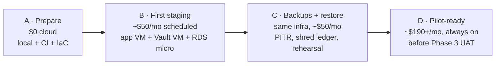
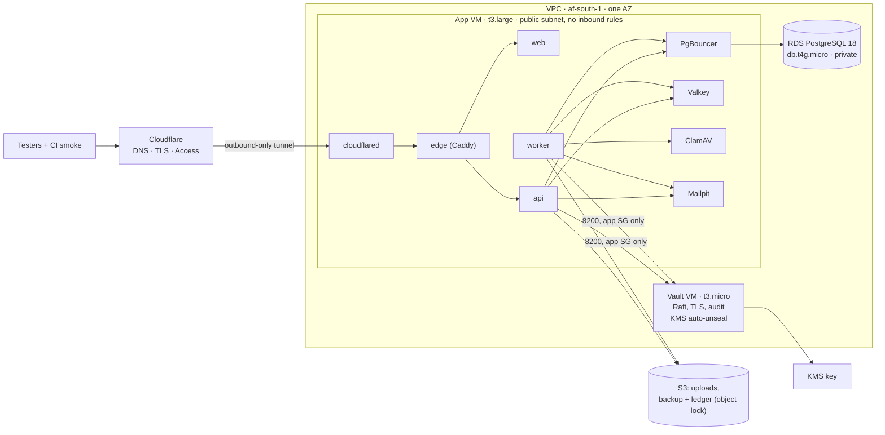

# Spec 0008 — Staging environment (revision 2: phased, credit-sized start)

**Status:** **Paused** (2026-10-12) by [ADR-030](../19-decision-log.md): the owner decided everything stays fully local, with nothing hosted or staged. This plan is kept as a reference only. Any future hosting needs a new ADR. (Previously: draft for owner review, revision 2, owner decisions recorded 2026-10-12.)
- **Revision 1 (2026-10-05):** one recommended configuration, about $190/month, 52% verified by value.
- **Revision 2 (this one):**
  - every price is re-checked against AWS's public price list (now **fully verified** for the lines that matter);
  - staging is split into **phases** sized to the credit;
  - Lightsail and a cheaper region are compared;
  - each phase lists which deferred Phase 0 criteria it closes.
  - The acceptance criteria SG1–SG8 are kept and two are added (SG9, SG10). D1–D6 are restated, with new decisions D0 and D7.

**Starting Phase B is an owner decision that amends ADR-024**, recorded as a new ADR when made. · **Phase:** 0 exit gate · **Builds on:**
- [10 §1–2, §7–8](../10-infrastructure-and-deployment.md);
- [09 §3–5, §4.2](../09-container-security.md);
- [16 §7](../16-compliance-ndpa.md);
- ADRs [015, 018, 023, 024, 025, 026, 029](../19-decision-log.md);
- [spec 0013](0013-container-images-scan-sign.md).

## Why now
**Phase 0 can't close without a deployed environment.** These criteria are deferred by ADR-024 ([18](../18-roadmap.md), reconciliation of 2026-10-11):
1. CSP and HTTPS cookies verified **on staging**;
2. an automatic deploy from `main`;
3. backups with a rehearsed restore;
4. ADR-018 closed, which needs staging to run the `vault` key provider ([ADR-023](../19-decision-log.md));
5. PgBouncer in the deployed path ([ADR-015](../19-decision-log.md)).

**"Images signed, 0 high/critical findings" is not on this list.** [Spec 0013](0013-container-images-scan-sign.md) meets it in CI. Staging *consumes* those signed images by digest.

**Planning now leaves the application queue alone.** Phase A below needs no cloud spend, so it can run alongside the remaining Phase 0 work. It also shows when the credit should start being spent.

## Hard rules for this spec (owner's standing rules)
- **The owner does every cloud-account action:** creating or upgrading accounts, entering payment details, enabling regions, billing settings, and holding root or admin credentials. Anything that needs the AWS console or CLI with write access is written below as **owner steps**.
- **No long-lived cloud keys in GitHub or on hosts.** CI deploys through an **OIDC role**; hosts use **instance roles**.
- **Synthetic data only** in staging. No real personal data, ever, at any phase of this spec.
- **No secrets, account IDs, IPs or personal data in the repo.** That includes this spec, IaC, logs and fixtures. Identifiers are placeholders (`<domain>`, `<account-id>`).

## 1. Price check (2026-10-11)

### 1.1 Source and basis
- **Source:** AWS's public **Price List bulk files** (`pricing.us-east-1.amazonaws.com/offers/v1.0/aws/<service>/current/<region>/index.csv`), plus the calculator's EC2 price map.
  - **Read on:** 2026-10-11.
  - **Publication dates:** RDS 2026-10-06; S3 effective 2026-09-01.
- **Basis:** USD, Linux on-demand, Single-AZ, 730 h/month, no commitments, tax excluded.
- **Not checked** (small at staging scale): data-transfer tiers beyond the free allowance, S3 and KMS request volumes, the NAT gateway's per-GB processing charge, interface-endpoint hours, and EBS prices outside Cape Town.

### 1.2 Unit prices, `af-south-1` (Cape Town), with `eu-west-1` (Ireland) for comparison
| Item | Cape Town | Ireland | Note |
|---|---|---|---|
| EC2 `t3.micro` (2 vCPU / 1 GiB) | $0.0136/h · **$9.93/mo** | $0.0114/h · $8.32 | |
| EC2 `t3.small` (2 / 2 GiB) | $0.0271/h · **$19.78** | $0.0228/h · $16.64 | |
| EC2 `t3.medium` (2 / 4 GiB) | $0.0542/h · $39.57 | $0.0456/h · $33.29 | Too small with ClamAV (§3) |
| EC2 **`t3.large`** (2 / 8 GiB) | $0.1085/h · **$79.21** | $0.0912/h · $66.58 | Unchanged since 2026-10-05 |
| EC2 `t4g.large` (Arm, 2 / 8 GiB) | $0.0867/h · $63.29 | $0.0736/h · $53.73 | Needs arm64 images (§6) |
| EC2 `m6i.large` (non-burstable) | $0.1270/h · $92.71 | $0.1070/h · $78.11 | `m7i-flex` isn't offered in Cape Town |
| RDS PostgreSQL `db.t4g.micro` (2 / 1 GiB) | $0.021/h · **$15.33** | $0.017/h · $12.41 | |
| RDS PostgreSQL `db.t4g.small` (2 / 2 GiB) | $0.041/h · $29.93 | $0.035/h · $25.55 | |
| RDS PostgreSQL `db.t4g.medium` (2 / 4 GiB) | $0.082/h · **$59.86** | $0.069/h · $50.37 | Revision 1 estimated ~$62 |
| RDS gp3 storage | $0.151/GB-mo | $0.127/GB-mo | 20 GB minimum |
| RDS backup storage | Free up to the DB's size, then $0.113/GB-mo | $0.095/GB-mo | |
| EBS gp3 | $0.1047/GB-mo | not checked | |
| Public IPv4 address (in use or idle) | $0.005/h · $3.65/mo | the same | Billed per address |
| NAT gateway | $0.057/h · **$41.61/mo** + per-GB processing | not checked | |
| S3 Standard | $0.0274/GB-mo | $0.023/GB-mo | |
| KMS customer key | $1/key-month; $0.03 per 10k requests (20k/month free) | the same | |
| Secrets Manager | $0.40/secret-month | the same | |
| CloudWatch Logs | $0.678/GB ingested; $0.036/GB-mo stored | $0.57; $0.03 | |
| ECR storage | $0.10/GB-mo | the same | |
| Lightsail | **not offered** (no price list for the region) | 8 GB bundle with IPv4: $0.05913/h · $43.16 | §4.3 |

### 1.3 Revision 1's configuration, re-verified
| Item | Revision 1 | Verified 2026-10-11 |
|---|---|---|
| App VM `t3.large` | 79.21 | 79.21 |
| Vault VM `t3.small` | 19.78 | 19.78 |
| RDS `db.t4g.medium`, Single-AZ | ~62 | **59.86** |
| RDS storage 20 GB gp3 (7-day PITR inside the free backup allowance) | ~3 | 3.02 |
| EBS 40 + 20 GB gp3 | ~6 | 6.28 |
| Public IPv4 × 2 | ~7.30 | 7.30 |
| S3 ~15 GB | ~0.50 | 0.41 |
| ECR ~10 GB | ~1.30 | 1.00. **Not needed** if images stay in GHCR (ADR-029), see D7 |
| KMS × 2 | ~2 | 2.00 |
| Secrets Manager × 10 | ~4 | 4.00 |
| CloudWatch Logs 10 GB ingested, 14 days stored | ~6 | 6.96 |
| **Total** | **≈ $190** | **≈ $189.82** |

**Conclusion:**
- **Revision 1's estimate holds.** Every priced line is now verified.
- **The credit doesn't fit it:** at about $190/month, **$100 lasts about 16 days**.
- **So the start has to be smaller and phased (§2).** It must not give up the controls staging exists to prove.

## 2. Phased plan

**The idea:** spend the credit on the thing only the cloud can prove (Phase B), and spend it slowly.
- **Run on a schedule:** office hours, plus a start on every deploy.
- **Build everything else first, for free** (Phase A).
- **Defer** anything that only matters for the pilot (Phase D).

| Phase | Monthly cost (Cape Town) | What it closes in Phase 0 (deferred list above) |
|---|---|---|
| **A · Prepare** | **$0** AWS (domain ~$10–15/year, paid by the owner outside AWS) | None. A deferred criterion needs staging. It does close ADR-015's **CI** obligation (isolation suite through PgBouncer) and spec 0013's third-party image item, and it makes B short |
| **B · First staging** | **≈ $50 scheduled** (≈ $121 always on) | **1** CSP + HTTPS cookies · **2** automatic deploy from `main` · **4** ADR-018 closure · **5** PgBouncer in the deployed path |
| **C · Backups and restore** | Same infrastructure: **≈ $50 scheduled** | **3** backups with a rehearsed restore, with the **shred ledger** built (spec 0006). After C, **every staging-deferred Phase 0 criterion is closed** |
| **D · Pilot-ready** | **≈ $190+ always on** (revision 1's shape, verified in §1.3), plus temporary larger instances for load tests | Nothing in Phase 0. It serves the pilot: UAT, DAST, and the ADR-026 load test on staging hardware |

**Credit runway (Phases B and C, Cape Town):**
- **Scheduled** (≈ $50–55/month, §4.1): $100 covers about **1.8 months**. That's enough to build B and probably C.
- **Always on** (≈ $121/month): about **25 days**.
- **After the credit:** either a run-rate of **≈ $50–55/month scheduled** until the pilot needs Phase D, or a teardown before the credit runs out. **Still open** (§7, D1b), and decided before Phase B starts.

**Phase 0 stays open after C anyway.** Other items remain, listed in [18](../18-roadmap.md):
- the four tracked gaps: product cache P7, `GET /users` pagination, key-forget broadcast, and the shred ledger (until C builds it);
- job isolation for the file-scan worker and the key sweep;
- `PolicyService`;
- the CI scans;
- lefthook and commitlint;
- the clean local E2E run, a separate follow-up.

### 2.1 Phase A: prepare (no cloud spend; can start now)
| Item | Closes or enables |
|---|---|
| **PgBouncer** (transaction pooling) in `compose.dev.yml`, plus a **CI job that runs the isolation suite through PgBouncer** | ADR-015's CI obligation; the roadmap's remaining-work item 4. The deployed half closes in B |
| **`infra/compose/compose.staging.yml`**: the docs/09 §4.2 hardened compose for the app host (read-only, UID 65532, `cap_drop: ALL`, `no-new-privileges`, tmpfs `/tmp`, internal `data` network, no published ports except the edge), with images **by digest only** | SG7. Rehearsed locally as ADR-024's local staging profile: HTTPS with a local CA, `Secure` cookies, an enforced CSP, Vault with TLS and its audit device |
| **Third-party images** (Caddy, cloudflared, PgBouncer, Valkey, Vault, Mailpit, ClamAV) pinned by digest and **scanned like ours** | Spec 0013 D5, "pending before staging" |
| **IaC** in `infra/terraform/` (OpenTofu-compatible), with Checkov/Trivy config scanning in CI, **plan only, never applied by CI in this phase**. Remote state in an encrypted, versioned S3 bucket with locking, created by the owner's bootstrap step (§5) | docs/09 §7; SG8's budget as code |
| **Deploy script**, run on the host by SSM: • pull the given digests; • `cosign verify` with ADR-029's exact identity, plus the attestations; • the migration one-shot; • `compose up`; • health checks. Tested against the local staging profile | SG3, SG10 |
| **Runbooks drafted:** deploy, rollback, restore (with the crypto-shred re-apply), Vault unseal and snapshot, cost guard | SG5, SG6 |
| **Configurable tenant hostnames for staging.** The resolver already matches exact hostnames (`apps/api/src/shared/tenancy/tenant-resolver.service.ts`), but the seed hard-codes `<slug>.univarse.localhost` (`packages/db/scripts/seed.ts`). Add a hostname pattern setting so staging seeds first-level names (D5), and test that only seeded hosts resolve | SG2 |
| **Spec 0013 publishing signed images from `main`** | A prerequisite for B (in progress in another session) |

### 2.2 Phase B: first staging (the credit starts here)
**Topology:** one app VM running the hardened compose, a separate small Vault VM, and the smallest managed PostgreSQL 18.

**Network and access** (cheapest option that keeps the controls):
- **No inbound ports at all on the app VM.** Cloudflare Tunnel (`cloudflared`) connects **outbound** to Cloudflare, which is the "origin only via Cloudflare" option in [10 §8](../10-infrastructure-and-deployment.md). That makes SG7's firewall rule "allow nothing in".
- **Administration through SSM Session Manager**, not SSH. No key pairs, no port 22, and sessions are logged.
- **No NAT gateway, no interface endpoints.** Each VM has an auto-assigned public IPv4 for outbound traffic only:
  - to GHCR, Cloudflare and the AWS APIs (SSM, KMS, S3, Parameter Store);
  - with no inbound rule except Vault's 8200 from the app VM's security group;
  - an auto-assigned address is **not billed while the instance is stopped**, unlike an Elastic IP.
- **IPv6-only isn't possible yet,** because GHCR has no IPv6.
- **RDS** sits in private subnets, reachable only from the app VM's security group, with `rds.force_ssl=1` and `sslmode=verify-full` ([09 §6](../09-container-security.md)).
- **Cloudflare Access** in front of the staging hostnames, so only testers and CI's smoke run (with a service token) reach the app. Staging isn't public.

**Secrets (SG4):**
- **SSM Parameter Store `SecureString`** (standard tier: no charge) replaces Secrets Manager in B–C.
- The instance role can read only its own path. The app's env files are rendered root-owned `0600` on the host at deploy time, never committed and never baked into images.
- **Revision 1 used Secrets Manager** (~$4/month). Parameter Store meets SG4 at this scale. Secrets Manager returns in D if rotation is needed.

**Vault (SG5, ADR-018 closure):**
- **The server:** single node, integrated Raft, on its own `t3.micro`, with TLS and its audit device on.
- **Unsealing:** **auto-unseal through one KMS key**, using the Vault VM's instance role, so a reboot or a scheduled start needs no person.
- **Tokens:** the app's AppRole can only call Transit `encrypt`/`decrypt`. The key-admin token stays off both VMs.
- **Snapshots:** a Raft snapshot goes daily to the backup bucket.
- **Licensing:** OpenBao stays the drop-in exit (ADR-023). D4 asks whether to start on OpenBao.

**Scheduling, with automatic deploy kept (SG3):**
- **When the VMs and RDS run:** an EventBridge Scheduler starts them about **12 h × 22 weekdays ≈ 264 h/month** and stops them otherwise.
- **Deploys outside those hours:** the deploy job **starts** them first and waits for health.
- **RDS has a limit:** a stopped RDS instance **restarts itself after 7 days**. The scheduler stops it again, and the budget covers the gap.

**CPU credits:** set `t3` instances to **`standard`** credit mode. Under sustained load they throttle to baseline instead of billing surplus credits ($0.05 per vCPU-hour in `unlimited`). That makes the cost predictable, which is the point at this stage. Watch ClamAV reloads and E2E runs, and switch to `unlimited` or `m6i.large` only with evidence.

**Deploy path (SG3, SG10):**
1. A push to `main` runs spec 0013's pipeline: build → test → scan → SBOM → publish → sign → verify.
2. A `deploy-staging` job (on `push` to `main` only, `environment: staging`) assumes the **OIDC deploy role**.
3. It starts the instances if they're stopped.
4. It runs the host's deploy script by **SSM Run Command**, passing **digests only**. No credentials go through command parameters, because SSM records them.
5. The host verifies the signature identity **before** pulling into compose.
6. It runs migrations as a one-shot container, then rolls the stack.
7. CI's **smoke E2E** runs against `demo-uni-staging.<domain>` through Cloudflare Access: login, MFA, step-up, and upload → scan → download.
8. A failed smoke run **stops the deploy**, rolls back to the previous digests (kept on the host) and fails the workflow, so GitHub notifies the owner.

**How the host pulls images (D7):** GHCR packages are private (ADR-029), so the host needs read access.
- **Recommended: mirror the verified digests to ECR**, inside the deploy job.
  - `cosign copy` keeps the digest and the signatures, so verification on the host is unchanged.
  - The host pulls with its **instance role**, so there's **no GitHub credential on the host**.
  - Cost: ECR ~$0.10/GB-month, under $1.
- **Alternatives:** a fine-grained read-only GitHub token in Parameter Store (a long-lived credential the owner creates and rotates), or public packages (the owner's visibility decision under ADR-029).

**What B proves:**
- **SG1–SG5 and SG7–SG10.** SG6 waits for C.
- **Spec 0008 D3's open question:** our `db:setup` role and grant statements on RDS **without superuser**, with PostgreSQL 18, `TimeZone=UTC` per connection, and `rds.force_ssl`. If that fails, D3 option B (self-managed Postgres 18 on the VM) comes back, with its backup work.
- **ADR-025's storage contract tests,** re-run against real S3.

### 2.3 Phase C: backups and a rehearsed restore (same infrastructure)
- **RDS automated backups with 7-day PITR.** At 20 GB this fits within the free backup allowance.
- **Backup bucket:** S3 **Object Lock** (compliance mode, short retention for staging), versioning on. It holds Vault snapshots and the **destruction (shred) ledger**.
- **The shred ledger** (spec 0006; a tracked gap until now) is built here. It sits outside the platform DB, and the restore runbook **re-applies crypto-shreds** from it, so a restored backup can't bring back a shredded key's data.
- **Rehearsal:**
  1. restore RDS to a point in time as a **new** instance;
  2. restore the Vault snapshot;
  3. re-apply the shreds;
  4. run the verification suite (isolation, login, a shredded tenant stays undecryptable);
  5. record the timings in `docs/ops/drills/`;
  6. delete the restored instance the same day. It costs a few hours of a `db.t4g.micro`.

**Evidence for "backups with a rehearsed restore":** the drill record.

### 2.4 Phase D: pilot-ready (later; not Phase 0)
- **The resource plan (§3) at full size, always on:** revision 1's ~$190, verified in §1.3. Before pilot UAT (Phase 3+), and probably larger as products land.
- **Additions:**
  - CloudWatch Logs (or the OTel pipeline) for retained logs;
  - Secrets Manager where rotation helps;
  - a 1-year Savings Plan once the shape is stable (~30–40% off compute);
  - **temporary larger instances for the ADR-026 load test** on staging hardware, which must run before the pilot;
  - DAST.
- **Then the pilot topology:** Kubernetes, Multi-AZ and HA Vault, sized in its own spec ([10 §2](../10-infrastructure-and-deployment.md)).

## 3. Resource plan (planning ranges; measured on the first deploy)
**Assumptions:** synthetic data; a handful of testers plus the smoke E2E after each deploy; no load tests in B–C. Figures from [10 §4.1](../10-infrastructure-and-deployment.md) where measured.

### App VM, `t3.large` (2 vCPU / 8 GiB)
| Container | Memory (limit) | Notes |
|---|---|---|
| `cloudflared` + edge (Caddy) | ~100 MB | Routes `/api` to the API and everything else to web |
| `web` (Next.js standalone) | 300–500 MB | |
| `api` | 250–400 MB | Argon2 on sign-in is the CPU spike |
| `worker` | 200–300 MB | Outbox, file scan, key sweep |
| PgBouncer (transaction pooling) | ~32 MB | ADR-015; pool sizes from ADR-026 |
| Valkey | 128 MB (`maxmemory`) | |
| Mailpit | ~64 MB | Staging never sends real email |
| **ClamAV** | **2.5–3 GB** limit | Measured peak 1.9 GiB while two databases are held during a reload ([10 §4.1](../10-infrastructure-and-deployment.md)) |
| Gotenberg | — | **Not deployed** until a feature uses it |
| **Total** | ~4.5–5 GB plus the OS | **8 GiB needed.** `t3.medium` (4 GiB) can't hold ClamAV alongside the app |

- **Disk:** 40 GB gp3 for images, ClamAV signatures and rotated logs. No tenant data lives on the host.

### Vault VM, `t3.micro` (2 vCPU / 1 GiB)
- 8 GB gp3. Raft data is kilobytes.
- `t3.micro` is the floor. If memory pressure appears, `t3.small` is +$9.85/month.

### RDS PostgreSQL 18, `db.t4g.micro`, Single-AZ
- 20 GB gp3 (the minimum), PITR 7 days (Phase C).
- Two databases: platform and `univarse_pool_01`.
- **1 GiB caps `max_connections` at roughly 100.** That's fine behind PgBouncer for a handful of testers. `db.t4g.small` is the step up (+$14.60/month always on).

## 4. Estimates for Phases B and C

### 4.1 `af-south-1`, verified unit prices from §1.2
| Item | Always on | Scheduled (264 h) |
|---|---|---|
| App VM `t3.large` | 79.21 | 28.64 |
| Vault VM `t3.micro` | 9.93 | 3.59 |
| EBS gp3 40 + 8 GB | 5.03 | 5.03 |
| Public IPv4 × 2 (auto-assigned, billed while running) | 7.30 | 2.64 |
| RDS `db.t4g.micro` | 15.33 | 5.54 |
| RDS storage 20 GB gp3 (backups within the free allowance) | 3.02 | 3.02 |
| S3 ~10 GB, plus requests | ~0.40 | ~0.40 |
| KMS: 1 key (Vault auto-unseal; RDS, S3 and EBS use AWS-managed keys) | 1.00 | 1.00 |
| ECR mirror (D7 option a) | ~0.30 | ~0.30 |
| Parameter Store (standard), SSM Session Manager, EventBridge Scheduler, Budgets | 0 | ~0 |
| Data out (behind Cloudflare; inside AWS's 100 GB/month free allowance) | ~0 | ~0 |
| **Total** | **≈ $121** | **≈ $50** |

**Notes on the scheduled column:**
- Deploys outside office hours add a little: each start runs about an hour.
- RDS's 7-day restart adds a little more. Budget **≈ $55**.
- **Not AWS costs:** a staging domain (~$10–15/year); Cloudflare Free (DNS, Universal SSL, Tunnel); Cloudflare Zero Trust Free for Access (the user limit is `[VERIFY]` at setup).

### 4.2 Cheaper variants (each gives something up)
| Variant | Saves (scheduled / always on) | Gives up |
|---|---|---|
| Vault as a container on the app VM (KMS auto-unseal kept) | ~$6 / ~$14 | The KEK shares the app host. It still runs the `vault` provider, but not in the production key topology. **D4** |
| `t4g.large` app VM (arm64) | ~$6 / ~$16 | Spec 0013 would have to build, test (CS5 journeys) and sign **arm64** images too. Not before 0013 is done |
| Self-managed Postgres 18 on the app VM instead of RDS | ~$8 / ~$18 | We'd build and run PITR ourselves (WAL archiving to S3), and the D3 RDS check isn't done. Only if D3 fails |
| `eu-west-1` (Ireland) instead of Cape Town | ~$7 / ~$17 (≈ 16%) | Not the documented GA region (§4.3) |

### 4.3 Region, Lightsail and NDPA
**NDPA:**
- **Staging holds synthetic data only,** so no personal data crosses a border. [16 §7](../16-compliance-ndpa.md)'s transfer basis isn't triggered by staging in **any** region.
- **That changes only if real personal data ever enters staging, which this spec forbids.** Truly anonymised data needs its own check `[VERIFY]` before use.
- **Production's transfer basis is a separate question.** It remains a `[VERIFY]` before the pilot, whichever region is chosen, because Cape Town is outside Nigeria too.

**Recommendation: `af-south-1`,** as revision 1 tentatively chose.
- **It's the GA region in [10 §2](../10-infrastructure-and-deployment.md),** so staging surfaces Cape Town's real differences early. Already found: no `m7i-flex`, no Lightsail, and a ~16–19% price premium on these lines.
- **The premium is about $7/month** on the scheduled plan.
- **Cons:**
  - it's an **opt-in region** the owner must enable;
  - whether the credit applies there must be checked (§5).
  - If either fails, Ireland is the fallback, with no design change.

**Latency** from Nigerian testers to Cape Town versus Europe isn't assumed here. The owner can measure it from Lagos before D2 (for example with a regional latency test) `[VERIFY]`.

**The Lagos Local Zone** isn't used. Local Zones don't host RDS, and staging doesn't need edge latency `[VERIFY]` its current service list before the pilot.

**Lightsail (considered, not recommended):**
- **Cheap:** an 8 GB bundle with IPv4 is $43.16/month in Ireland.
- **Not offered in Cape Town.**
- **No instance IAM role,** so S3, KMS and Parameter Store access would need **long-lived access keys on the host**, against our rules.
- **A different shape from production,** and its managed database isn't PostgreSQL 18 `[VERIFY]`.

## 5. The credit, and owner steps

### 5.1 What to check about the $100 credit (owner, in Billing → Credits)
**What the AWS Free Tier FAQ says (read 2026-10-11):**
- **Sign-up credits on the Free plan** expire **6 months** after account creation.
- **When the Free plan ends,** the account is **suspended** and later erased.
- **On the Paid plan,** credits last **12 months** from sign-up and apply automatically to "participating services".
- **Restrictions:** the Free plan restricts some services. The FAQ doesn't list which, and doesn't say whether opt-in regions are included.

**So, before Phase B the owner confirms:**
1. **Where the credit came from** (a sign-up credit or a promotional credit), its **expiry date**, and its **eligible services** (EC2, RDS, S3, KMS, VPC/IPv4 in `af-south-1`).
2. **The account plan.** Staging should run on a **Paid-plan** account, with the budgets below, so it isn't suspended when the credit runs out. Credits still apply first.
3. **That the credit's expiry leaves enough time.** If it expires within months, **Phase A should finish first**, so the credit is spent on B and C rather than lost. This is **D0**.

### 5.2 Owner steps (in order; all need console or admin rights, so the owner does them)
1. **Account:**
   - confirm the plan and the credit (§5.1);
   - **MFA on root**, and no root access keys;
   - create an admin user through **IAM Identity Center** for day-to-day work.
2. **Region:** enable `af-south-1` (opt-in), or choose the fallback (D2).
3. **Budgets (SG8):**
   - a monthly **cost budget at the D1 ceiling**, with alerts at **50%, 80% and 100% of actual cost** and a **forecast** alert at 100%;
   - **credits excluded from the budget's charges,** so alerts track real usage while the credit hides it;
   - a **budget action** at 100% that stops the tagged EC2 and RDS instances (SG8);
   - **Cost Anomaly Detection** on.
4. **Terraform state bootstrap:** an S3 bucket (versioned, encrypted, public access blocked) for state, with S3-native locking.
5. **GitHub OIDC:**
   - **The identity provider:** `token.actions.githubusercontent.com`.
   - **A deploy role** trusted only for `repo:w1t3ack3r/univarse:environment:staging`. Its permissions:
     - start/stop/describe the tagged instances and the RDS instance;
     - `ssm:SendCommand` limited to the deploy document and the tagged app instance;
     - ECR push to the staging repositories (D7a).
   - **A separate plan-only role** for IaC `plan`. No apply from CI until the owner approves that in a later decision.
6. **The first `apply`:**
   - **Who runs it:** the owner, from their machine, with their own credentials, reviewing the plan that CI produced.
   - **Credentials:** they are never shared with Claude or pasted into chat or the repo.
7. **Cloudflare:** the staging domain (D5) on Cloudflare; the tunnel created (its token stored by the owner in Parameter Store); Access applications for the staging hostnames, with a service token for CI stored as a GitHub environment secret.
8. **Vault:** initialise Vault and keep the **recovery keys and the root token** offline. Revoke the root token after setup. Create the key-admin token, held by the operator and never on a VM.

**Claude's part:** IaC, compose, scripts, runbooks and pipeline code in PRs; reading plans and logs the owner shares (with secrets redacted). Claude never holds cloud, Vault or registry credentials (D6).

## 6. Acceptance criteria
Built in Phases B–C after the decisions. Each criterion's phase is listed.

| ID | Phase | Acceptance criterion |
|----|----|---|
| SG1 | B | *Same shape as production, smaller.* The edge (TLS) in front of web, API and worker; PostgreSQL 18 (platform + one pool shard) behind **PgBouncer in transaction pooling**; Valkey; Vault; Mailpit. **Synthetic data only.** |
| SG2 | B | *Real TLS and browser security.* • The staging tenant host (first-level, e.g. `demo-uni-staging.<domain>`; D5) serves only HTTPS with HSTS. • `__Host-` cookies are `Secure`, `HttpOnly` and `SameSite`. • The CSP is **enforced** (not report-only), with per-request nonces. • **Checked automatically against staging after each deploy.** **Closes** Phase 0's "CSP + HTTPS cookies on staging". |
| SG3 | B | *Automatic deploy from `main`.* A merge runs spec 0013's pipeline, then deploys **by digest**. It starts stopped instances, runs migrations, then the smoke E2E. A failed smoke run rolls back and fails the workflow. **Closes** "automatic deploy from `main`". |
| SG4 | B | *Secrets.* • None in the repo or images. • Runtime secrets come from Parameter Store `SecureString` (B–C) through the instance role, which is scoped to its own path. • The Vault AppRole secret and the Postgres role passwords are per environment. • No long-lived AWS keys anywhere: CI uses OIDC, hosts use instance roles. |
| SG5 | B | *Vault in a staging-grade setup.* • Its own VM (unless D4 says otherwise). • KMS auto-unseal, TLS, the audit device on. • Daily Raft snapshot to the backup bucket. • The app token can only call Transit `encrypt`/`decrypt`. The key-admin token is held outside both VMs. • The app runs `KEY_PROVIDER=vault`, and a test proves a destroyed tenant DEK makes that tenant's values undecryptable **on staging**. **Closes ADR-018.** |
| SG6 | C | *Backups and a rehearsed restore.* • RDS PITR, 7 days. • An Object Lock backup bucket holding Vault snapshots and the **shred ledger**. • One rehearsed restore that **re-applies crypto-shreds**, recorded in `docs/ops/drills/`. **Closes** "backups with a rehearsed restore", and the shred-ledger gap. |
| SG7 | B | *Host hardening* ([09 §4.2, §5](../09-container-security.md)). • **No inbound** security-group rules on the app VM (Cloudflare Tunnel). The Vault VM allows only 8200 from the app's security group. • SSM Session Manager instead of SSH; unattended security updates; chrony. • Containers: non-root, read-only root filesystems, dropped capabilities. • No data port published. An **external port scan shows nothing open.** |
| SG8 | A–B | *Cost guard.* • An AWS Budget at the D1 ceiling, on actual cost excluding credits, with alerts at 50%, 80% and 100%, a forecast alert, and anomaly detection. • **Alerts don't stop spending.** A **budget action** at 100% stops the tagged EC2 and RDS instances. It isn't a hard cap: billing data lags by hours, and storage keeps billing while stopped. • The office-hours schedule is on. • `t3` instances in `standard` credit mode. • **Monthly spend recorded** in this spec's completion record. |
| SG9 | B | *PgBouncer.* The isolation suite passes **through PgBouncer in transaction pooling**: in CI (Phase A) and as the deployed path (Phase B). **Closes** ADR-015's two obligations. |
| SG10 | B | *Only verified images run.* The host refuses to run any digest whose `cosign verify` with ADR-029's exact identity, or whose attestation verification, fails. Third-party images run by digest, scanned under spec 0013's rules. A negative test deploys an unsigned digest and must fail. |

**Also proved in B, but not as Phase 0 criteria:** the D3 role and grant check on RDS, and ADR-025's storage contract tests against S3.

## 7. Owner decisions (recorded 2026-10-12)
These record the owner's choices for the plan. **None of them starts Phase B:** that needs the D0 ADR and a review of the deployment plan. Each one still depends on the checks named in its row.

| # | Decision | Owner's choice | Condition or open point |
|---|---|---|---|
| **D0** | **When Phase B starts** | **Finish Phase A and spec 0013's signed-image pipeline first.** Then review the deployment plan before launching B | A new ADR amending ADR-024, written when B is approved |
| **D1a** | **Monthly ceiling** | **$60/month planning target**, on the office-hours schedule | Enforced by SG8's budget alerts and its budget action, which isn't a hard cap |
| **D1b** | **After the credit** | **Open.** Either keep staging at up to $60/month, or tear it down before the credit runs out. A teardown keeps the IaC and runbooks, but loses database and Vault data unless snapshots are kept (small storage cost) | **Decided before Phase B starts.** A Paid-plan account bills once the credit is used up |
| **D2** | **Region** | **`af-south-1` (Cape Town)** | After the owner confirms the credit applies there and enables the region (§5). Otherwise `eu-west-1`, with no design change. IaC stays region-parameterised |
| **D3** | **Database** | **RDS PostgreSQL 18, `db.t4g.micro`, Single-AZ** | After the owner confirms availability (`aws rds describe-orderable-db-instance-options --engine postgres --region af-south-1`, read-only, filtered to version 18 and the class), and after the `db:setup` role and grant check passes without superuser. Otherwise self-managed (§4.2) |
| **D4** | **Vault** | **Vault on its own `t3.micro` with KMS auto-unseal** | Vault 2.1.1 as integrated. OpenBao stays the tested exit |
| **D5** | **Domain and TLS** | **An existing domain the owner holds.** It's named outside this public repo and written here as `<domain>`. Staging uses **first-level hostnames** such as `demo-uni-staging.<domain>`, so Cloudflare's free Universal SSL covers them. A two-level name such as `demo-uni.staging.<domain>` isn't covered | **Phase A:** the configurable seed hostname pattern (§2.1). **Same-site caution:** if `<domain>` also serves production, staging and production hosts are *same-site*. Host-only `__Host-` cookies don't cross hosts, but `SameSite` would no longer separate a less-hardened staging host from production. **Revisit D5 if production is planned on `<domain>`** (docs/10 names a different production domain) |
| **D6** | **Credentials** | **Unchanged:** the owner holds root, admin, Vault recovery and key-admin credentials; CI uses OIDC; servers use limited IAM roles; Claude holds none | |
| **D7** | **Images** | **Mirror verified digests and their signatures to ECR** with `cosign copy`; servers pull with their IAM role | No GitHub credential on any server |

## 8. Docs to update when Phase B is approved
- **docs/19:** a new ADR amending ADR-024 (D0), with the after-credit decision (D1b), region (D2) and Vault placement (D4); and one for Cloudflare Tunnel plus SSM-only access, if accepted.
- **docs/10 §2, §7–8:** the staging row (scheduled, tunnel, Parameter Store), and staging PITR.
- **docs/09 §4.2:** link to `compose.staging.yml` once it exists.
- **docs/18:** Phase 0's deferred criteria marked as closed **only** when SG2, SG3, SG5, SG6 and SG9 have evidence.

## Out of scope (tracked)
| Gap | Milestone |
|---|---|
| Kubernetes, Multi-AZ, read replica, HA Vault (3 nodes), DR replication | Pilot or production ([10 §2](../10-infrastructure-and-deployment.md)) |
| ADR-026 load test on staging hardware; DAST | Phase D, before the pilot |
| NDPA transfer basis and DPAs | Before any real personal data ([16 §7](../16-compliance-ndpa.md)) |
| Separate AWS accounts per environment (Organizations) | Before production ([10 §1](../10-infrastructure-and-deployment.md)) |
| arm64 images (`t4g` savings) | After spec 0013, if wanted |
| Product cache across instances (spec 0003 P7), `GET /users` pagination, key-forget broadcast | Unchanged: still open |
| Shred ledger | Built in Phase C (SG6); open until then |
| Clean local E2E run | Pending separately |
